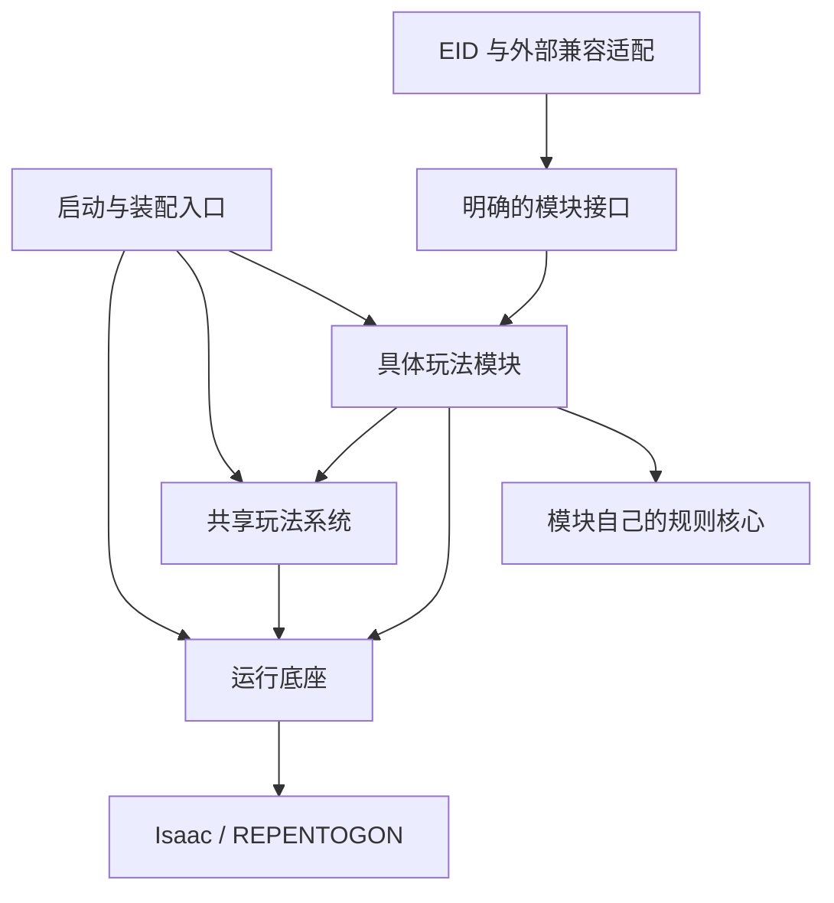

# Neverbirth 目标架构与渐进重构路线

初稿日期：2026-11-24（Europe/Warsaw）；要求补充：2026-11-25。

状态：用户已认可架构方向，并明确要求逐道具独立模块、`include` 装配、薄入口与公共能力复用；迁移和验收进度以当前源码及各批记录为准。本文中的初次审阅数据保留为历史基线。

适用项目：目录名 `neverbrith`，代码及公开对象中的 `Neverbirth` 等现有拼写分别保留。

## 1. 重构要达成什么

Neverbirth 的目标框架是：**运行底座精简、玩法模块完整、跨模块协作明确的模块化单体。**

开发一个新道具时，开发者应当只需要理解该道具的规则和少数公共接口。修改一个公共机制时，应当能明确列出受影响的模块、存档、回调与测试。

重构以这些能力衡量成果：

- 从道具名称能够直接找到它的规则、状态、接入和表现。
- 每份状态都有明确所有者、生命周期、保存策略和回退策略。
- 模块通过明确接口协作，不读取其他模块的内部存档表或测试入口。
- 多个真实消费者所需的同义公共能力由明确模块集中维护；道具保留专属规则，避免每迁出一件道具就复制一套辅助机制。
- 关键回调顺序、返回值和重入行为能够解释并验证。
- 一个模块可以被独立测试；真实入口和关键组合也有集成检查。
- 每批迁移范围清晰，能单独验证、单独回退。

主文件变短、目录变整齐是这些边界形成后的结果，不能独立证明设计已经改善。

### 1.1 本文的依据与范围

本方案初稿来自 2026-11-24 对当时工作区源码的独立审阅，未读取另一个聊天的回答，也未读取其重构方案。审阅覆盖启动入口、共享状态、代表性玩法、跨模块依赖及相关测试；不是对所有道具进行逐行审计。

初稿只形成架构文档；后续补充固化用户确认的要求，不把文档更新当成实现完成。实现阶段以当时的源码、已确认设计与新执行的检查为准。

项目已有大量未提交改动。任何迁移都必须先辨认这些改动的归属，不能通过重置、清理或整文件覆盖来消除无关差异。

### 1.2 保持既有合同

沿用已确认的玩法、道具池、品质、资源风格、存档语义和公开兼容接口。若现有实现与已确认设计冲突，记录具体差异，再按相关合同处理。

架构整理不自动决定以下事项：

- 哪个道具应当压过另一个道具的输入或攻击。
- 某份状态是否应随沙漏回退、跨层保留或继续游戏恢复。
- 伤害支付、免伤、致死保护之间的新玩法关系。
- 新增依赖、修改原生运行时、提交、推送或发布。

## 2. 当前结构中的主要问题

审阅时 [main.lua](../../main.lua) 共 20,882 个物理行。这个数量描述当时快照，不作为长期验收门槛。

| 当前源码证据 | 结构问题 | 目标归属 |
| --- | --- | --- |
| `EnsureMusicboxDataLoaded()` 初始化八音盒、天使盒、骰子套装、黑太岁、记忆紊乱等数据 | 全项目存档设施与具体道具混合 | 独立存档服务；模块拥有自己的数据定义 |
| [斗气拳套](../../drive_glove.lua)与[凸眼鱼](../../blinky.lua)依赖 `PendingContentState.InventoryPlayerKey` | 公共身份能力归属于某批内容的历史接入模块 | 独立身份服务，保留不同身份语义 |
| `main.lua` 的斗气拳套装配读取 `RingOfSevenCursesTestAPI` | 正式协作和测试访问混在一起 | 正式查询接口；测试观察单独处理 |
| 炸弹套装、我即神明使用 `BurnAwayResentment.GetPlayerHeadWorldPosition` | 通用位置计算寄存在某件道具内部 | 玩家表现定位工具 |
| 骰子回调处注释说明其位置用于兼容测试按顺序取回调 | 测试依赖内部排列，限制源码组织 | 依照事件、过滤参数和行为寻找处理器 |
| [共享状态服务](../../pending_content_state.lua)同时处理身份、获取记录和快照参与者 | 多种可复用职责集中在历史功能名下 | 按实际职责提炼，保留已有行为证据 |

这些证据说明边界需要调整，不等于已经证明对应玩法存在运行故障。

### 2.1 应当保留的结构

- [斗气拳套规则核心](../../drive_glove_core.lua)已经把主要状态转移从接入代码中分离。
- [搓招识别核心](../../motion_input_core.lua)、[道具绑定](../../motion_items.lua)、[战斗执行](../../motion_combat.lua)和[表现](../../motion_presentation.lua)已经形成有价值的职责划分。
- [获取与快照服务](../../pending_content_state.lua)已有实物身份、临时复制和快照参与机制。
- [伤害顺序测试](../../tests/repentogon_damage_order_test.lua)使用真实入口的注册记录及已安装调度代码验证关键组合。
- [生成道具登记](../../generated/neverbirth_collectibles.lua)已有明确生成来源。

重构应当推广这些有效边界，继续使用其验证证据。

## 3. 目标结构与依赖方向



箭头表示依赖或使用；这不是统一的逐帧执行流程。玩法接入代码仍可以直接使用必要的引擎 API，不需要把每一个 `EntityPlayer` 方法再包装一遍。

| 部分 | 负责 | 边界 |
| --- | --- | --- |
| 启动与装配 | 前置检查、服务创建、依赖连接、模块安装、公开接口发布 | 不包含具体道具的规则和状态机 |
| 运行底座 | 存档读写、生命周期协调、身份解析、能力检测、日志和诊断 | 不点名判断具体道具的玩法 |
| 共享玩法系统 | 获取记录、输入与攻击占用、伤害来源等真实复用机制 | 只提炼已存在的共同合同 |
| 具体玩法模块 | 自己的规则、状态、接入和专属表现 | 通过正式接口使用外部能力 |
| 内容登记与文本 | 内部标识、运行时 ID 映射、语言文本、资源登记关联 | 每项事实有确定来源 |
| 外部适配 | EID、其他 Mod 登记、现有公开 API 的兼容 | 不通过内部状态表拼装功能 |

### 3.1 候选目录结构

下列路径用于表达目标归属，不表示清单中每个文件都已创建。实际位置见[项目地图](../agent/project-map.md)；最终目录命名可结合迁移成本调整，但必须满足逐道具定位与职责独立的要求。

```text
main.lua                       薄入口：前置检查与装配
scripts/
  bootstrap.lua                显式创建和连接实例
  runtime/
    capabilities.lua           运行环境和扩展能力
    identity.lua               玩家、身体、运行时实体身份
    lifecycle.lua              生命周期协调
    persistence.lua            读写、版本和模块数据区域
    callback_registration.lua  薄登记层与诊断
  systems/
    acquisition.lua            实际获得、临时复制与实物记录
    control_ownership.lua      输入、移动和攻击占用
    damage_attribution.lua     已验证的伤害来源归属
    player_geometry.lua        通用玩家表现定位
  features/
    essential_balm.lua         简单功能保留单文件
    musicbox/                  八音盒自己的规则和接入
    drive_glove/               规则、接入、武器、声音、表现
    motion/                    输入、绑定、战斗、表现
  catalog/                     登记解析与文本消费
  integrations/                EID 与公开兼容门面
generated/                     生成产物及来源说明
tests/                         规则、模块、集成和资源检查
tools/                         检查、生成与交付工具
content/                       引擎内容登记
resources/                     引擎资源
```

目录只是职责的承载位置，不要求第一批就创建所有文件。只有真实职责和消费者明确后，才建立对应公共模块。

### 3.2 依赖约束

1. 底座不能随着每新增一个道具，就增加一个识别该道具的分支。
2. 共享服务由装配层创建并保有实例；消费者复用同一实例。
3. 功能之间的依赖在装配时明确传入，避免通过巨大 `context` 或全局对象任意查找。
4. 规则核心尽量只处理普通数据和明确输入；必要的时钟、随机源和外部查询显式提供。
5. 表现消费已经确定的状态或事件，不负责扣血、消耗、奖励和玩法计时推进。
6. 真正的功能依赖可以存在，但必须命名并验证；不要求所有模块在缺失必要服务时继续工作。

### 3.3 main.lua 必须收缩为薄入口

2026-11-25 用户明确要求：整轮入口重构的目标是迁出 `main.lua` 中全部道具实现，逐件独立组织，再由入口通过 `include` 显式加载和装配。允许分批实施，但不能把第一、第二批或任意部分道具迁出当成整个入口重构完成。

最终 `main.lua` 的职责限定为：

- 执行前置检查并创建 Mod。
- 调用登记解析、语言和兼容等专属模块，取得装配所需接口。
- 创建并持有共享服务实例，明确连接模块依赖。
- 通过 `include` 按确定顺序安装道具及共享系统，发布必要的兼容接口。

道具规则、道具专属状态、实际回调处理函数和生命周期处理必须由相应模块拥有。登记数据、语言文本、存档和兼容能力也应按各自职责归属；入口调用其初始化接口，不继续承载大段具体实现。

可以使用专门的装配模块或显式安装阶段，但它们同样只负责依赖连接和安装。将旧主文件整体搬进 `bootstrap.lua`、一个通用 `items.lua` 或另一个大文件，不满足薄入口要求。验收看职责归属、加载关系和行为证据，不设一个可通过搬文件绕过的行数门槛。

## 4. 具体玩法模块的合同

### 4.1 按完整玩法组织

默认一件道具一个独立文件；复杂道具可以使用独立目录，并有唯一、明确的入口，内部再按需要拆分规则、运行接入、表现和状态定义。

不把所有道具的更新逻辑集中到一个全局 `update.lua`，也不强制每件小道具都生成同样数量的文件。

以斗气拳套为例：

| 部分 | 输入与输出 |
| --- | --- |
| 规则核心 | 当前模式、斗气、逻辑时间、输入 → 状态变化及防御、力竭等结果 |
| 运行接入 | 引擎事件 → 调用规则 → 执行实际游戏操作 |
| 武器处理 | 根据已确认武器合同执行蓄力与发射相关操作 |
| 表现 | 读取已确定结果，绘制 HUD、播放音效及特效 |
| 状态定义 | 声明保存内容、清理条件、恢复和重建步骤 |

#### 4.1.1 逐道具模块化要求

以下要求于 2026-11-25 经用户确认，适用于后续迁移和整体验收：

1. 每件道具必须能通过名称或稳定内部标识定位到自己的独立文件或目录入口。复杂度不同可以采用不同文件数量，但不能只有一个难以追踪的全局分支。
2. 每件道具的规则、数值、触发条件、私有运行状态、回调处理和生命周期策略由该模块负责。仅搬出部分函数，仍把专属状态与清理逻辑留在 `main.lua`，属于未完成迁移。
3. 同系列道具可共用机制实现，但每件仍须有独立、实际被加载的配置或入口文件，并在迁移清单中逐项登记。配置需要明确身份、差异参数和共享实现；空壳文件不能作为完成证据，也不复制多份共同机制。
4. 共享机制进入对应服务或系统，模块显式接收所需依赖。消费者通过正式查询或操作接口协作，不通过另一个道具的私有表或 `TestAPI` 取得能力。
5. 道具模块拥有回调函数和登记实现，装配层决定安装顺序。若原有回调穿插在其他功能之间，采用明确的安装阶段或登记接口保持相对顺序；迁移中的旧登记位置须记录退出条件，不能为了集中 `include` 而按文件名字母顺序重新排列行为。
6. 同一安装实例只执行一次有状态初始化。取得已有模块能力时复用实例或传入的接口，不重复执行工厂；具体安装合同沿用第 4.3 节，失败清理按第 9.6.2 节验收。
7. 根目录中既有独立模块也应进入逐道具清单，核对入口、所有权和依赖后复用。符合合同的模块不因目录风格而强制重写；位置与映射必须明确。

本要求不改变既有玩法、数值、道具池、品质、资源、存档格式、继续/沙漏语义和回调合同。若迁移中发现行为缺陷，按第 11.1 节单独记录修复及验证，不将其混入无说明的结构调整。

### 4.2 查询与操作分开

建议接口可以采用以下形状，名称为示例，不是现有 API 承诺：

```lua
feature.IsActive(player)
feature.GetIncomingDamageMultiplier(player)
feature.Execute(player, request)
feature.Cancel(player, reason)
```

查询应避免消耗游戏 RNG、扣费、修改道具池或触发效果。返回内部表时必须明确其所有权；优先返回必要的值、只读约定视图或副本。

操作必须说明成功、失败和取消的含义，并明确谁结算费用、冷却和奖励。一个引擎回调处理函数不自动成为通用效果 API。

正式调用方不得依赖 `TestAPI`。测试可以使用正式接口、可注入依赖或专门的观察设施，不能让生产模块通过测试入口协作。

### 4.3 模块实例与安装

可以继续采用现有 `return function(mod, dependencies)` 风格。复杂模块需要区分构造和注册时，再拆成显式阶段。

每个模块必须明确：导出什么、谁创建实例、何时注册回调、消费者是否共享实例、如何清理与替换。

`include` 每调用一次都会重新执行模块代码。因此不能为了获取一个方法，再执行一次有状态模块的初始化。装配层应保存返回实例并传给消费者。加载器缓存本身也不能代替生命周期管理。参考 [Isaac 模块加载文档](https://wofsauge.github.io/IsaacDocs/rep/tutorials/Using-Additional-Lua-Files.html#include)。

## 5. 状态与生命周期：最高优先级

### 5.1 三个维度分别定义

| 维度 | 要回答的问题 |
| --- | --- |
| 所有者 | 整局、逻辑玩家、角色身体、实体、房间，还是某份道具实物？ |
| 生命周期 | 创建、换房、换层、死亡、失去道具、退出和继续时怎样处理？ |
| 持久与回退 | 是否保存？是否随沙漏回退？恢复后重建哪些对象？ |

这些维度不能互相代替。属于整局的数据可以需要保存，同时明确不随沙漏回退。

每个模块维护自己的状态合同：

| 字段或状态组 | 所有者 | 创建与更新 | 清理条件 | 继续游戏 | 沙漏 | 恢复后重建 |
| --- | --- | --- | --- | --- | --- | --- |
| 迁移时逐项填写 | 使用经验证的身份语义 | 指明唯一推进者 | 按已确认规则 | 保存或重建策略 | 显式策略 | 缓存、实体、表现等 |

### 5.2 存档服务统一机制，模块保留含义

- 存档服务统一负责 JSON 和磁盘读写，以及明确的加载完成状态。
- 各模块注册自己的数据区域、默认值、版本、校验和迁移函数。
- 模块只获得自己所需的数据权限，不默认暴露整个存档根。
- 首批迁移通过适配层复用旧字段和旧格式；避免把代码搬迁与存档格式升级混为一批。
- 后续格式升级应有旧存档样本和迁移测试；遇到无法迁移的数据，明确报告，不能静默用空表覆盖。
- 保存可以合并，但必须保持原有结算点的可靠性；需要立即写入的场景应能明确请求。

### 5.3 沙漏采用显式参与机制

当前 [blinky.lua](../../blinky.lua)明确把储物袋放在共享沙漏快照之外，[motion_combat.lua](../../motion_combat.lua)则对战斗气量等状态维护快照。[pending_content_state.lua](../../pending_content_state.lua)已有参与者捕获和恢复接口。

目标框架应允许各模块注册捕获、清理、恢复和重建步骤，同时声明哪些数据参与回退。不能直接复制、恢复整个全局状态表。

恢复涉及相互依赖的模块时，顺序应有明确理由。具体边界由已有合同和测试决定，不能将某一功能的恢复顺序套用到所有功能。

### 5.4 身份服务提供不同身份语义

不强推一种万能 `PlayerKey`。至少要区分：

- 需要共享某些数据的逻辑玩家身份。
- 当前角色身体及其独立背包身份。
- 只在当前运行时有效的实体身份。
- 有独立耐久或来源记录的道具实物身份。

当前共享服务已经处理拉撒路形态共享与身体区分；[记忆紊乱](../../memory_disorder.lua)也区分持久键和运行时实体键。迁移应先保留这些差异，再用继续游戏、角色切换和多人案例验证映射。

不能仅凭种子、控制器索引或实体指针看起来唯一，就认定它能跨生命周期使用。

### 5.5 运行时数据独立管理

实体、玩家、Sprite、Room 等对象不写入存档。恢复后重新取得或重建。

模块不能继续持有恢复前已经被替换的数据表。延迟操作需要绑定所有者和有效生命周期，在换房、失去道具、退出或实例失效时按既有规则取消。

计时器需要注明逻辑帧、渲染帧或其他时钟单位，以及暂停和慢动作行为。一个状态阶段只能有明确的推进与结算所有者。

## 6. 共享能力与玩法系统

| 能力 | 当前需求 | 提炼后的边界 |
| --- | --- | --- |
| 身份解析 | 多个模块自行组合种子、控制器和指针 | 按用途提供经验证的身份 |
| 获取与实物记录 | 区分碰撞、真正获得、临时复制和重新拾取 | 保留已确认来源与结算证据 |
| 输入和攻击占用 | 特殊攻击、背包选择器和主动道具之间协商控制 | 持有者明确，可释放自身占用 |
| 伤害分类与归属 | 普通伤害、支付伤害、持续伤害与击杀来源 | 提供已验证信息，不决定所有道具反应 |
| 玩家表现定位 | 多功能使用头部位置等计算 | 与具体道具解耦的工具 |
| 文本和内容查询 | HUD、提示、EID 使用同一内容身份 | 统一读取，保留不同显示面的需求 |

### 6.1 输入占用的目标

一个功能申请占用移动、射击或其他控制，获得属于自己的句柄。结束时释放自己的句柄，不能无条件恢复其他功能仍在限制的控制。

竞争、抢占、共存和取消规则必须显式表达，并保持已确认玩法。首批可以选择已存在互相避让的功能进行迁移，不能未经组合验证就覆盖全项目输入。

该服务只协调本模组明确拥有的控制；与第三方 Mod、原生角色机制的交互仍需要相应验证。

### 6.2 伤害服务的目标

共享已有的来源解析和分类工具，保留每件道具自己的触发政策。同一种支付伤害是否触发某道具，由该道具合同决定。

实际接受的伤害、命中尝试和伤害来源记录不能混为一件事。奖励或击杀归属应沿已验证的回执路径结算。

### 6.3 公共能力复用是独立的重构目标

2026-11-25 用户明确要求：重构需要同时完成道具职责独立和公共能力复用。将重复机制原样搬到不同道具文件中，只能算结构迁移，不能据此宣布公共能力整理完成。

每批迁移必须遵守以下要求：

1. **先查已有能力**：盘点本批道具使用的辅助函数、查询、转换和状态设施，搜索其他消费者及既有共享接口。既检查直接复制，也检查改名、改写后仍具有相同合同的实现。
2. **按语义确认复用**：列清输入、输出、副作用、错误处理、数值边界和生命周期。确认多个真实消费者需要同一能力后，应复用已有实现或提取一个明确的共同实现；代码相似但合同不同的部分，保留差异并说明依据。
3. **共享机制，保留规则**：基础查询、数据转换和共同状态设施可以复用；道具触发条件、数值、上限、奖励、支付伤害反应和清理政策仍由对应道具负责。公共模块不通过一串道具 ID 分支重新集中全部玩法。
4. **归属与实例明确**：纯计算优先采用无状态函数；有状态服务由装配层创建，并说明哪些消费者共享同一实例、哪些状态必须隔离。已被多个功能复用的能力若寄存在某件道具内部，也应核对归属；不能为了取一个函数而重新初始化整件道具。
5. **实际切换消费者**：提取公共实现后，本批对应消费者必须通过正式依赖使用它。保留原重复算法、只在外层再套一个公共函数，或者只创建无人使用的工具文件，不能算完成。薄兼容适配可以暂留，但要登记消费者和退出条件。
6. **保持行为与数据兼容**：提取时保持原有数值边界、键格式、存档语义、回调顺序、RNG 消费顺序及异常传播方式。现有差异先对照验证；不能为统一接口顺带决定新行为。缺陷修复按第 11.1 节单独说明。
7. **记录本批处理结论**：按第 12.2 节记录复用候选、全部已发现消费者、共同实现和保留差异。跨批次暂缓的项目列为未完成项，说明原因、范围及后续条件；不能以“已拆成独立文件”关闭它。

公共模块按具体职责命名和组织，避免形成无限扩大的 `utils.lua`。不要求为单次调用、普通 API 转发或只出现一次的逻辑增加抽象，也不以“重复代码行数为零”作为目标。判定依据是是否存在真实的共同合同、共享后是否减少维护分叉，以及消费者能否清楚理解接口。

### 6.4 需要优先核对的复用候选

下列方向来自本次源码检查，用于启动共享能力清单，不代表这些能力都已完成提取；实施前需要按最新源码重新定位消费者。

| 候选能力 | 已观察到的使用场景 | 提取时必须保留的区别 |
| --- | --- | --- |
| 运行环境访问 | 多件道具分别实现 Game、Room、Level 查询及异常处理 | 运行中、退出和卸载的可用性；必需依赖与可选能力的失败合同 |
| 房间、楼层、玩家与运行身份 | 多件道具自行拼接索引、种子、控制器或实体指针 | 当前房间与跨层身份、逻辑玩家与身体身份、持久键与运行时键，不能强推万能身份 |
| 射速与发射间隔转换 | 狗粮系列、回声宝宝、零分考卷和斗气拳套等 | 换算可共享；射速上限、倍率、奖励阈值和边界值保护按原合同处理 |
| 普通数据复制 | 临时复制、回声宝宝、获取记录及快照 | 普通数据树、循环引用、元表和运行时对象的处理边界；不能把所有对象交给一个无约束的深复制函数 |
| 伤害信息与表现定位 | 多件道具处理来源、标记、致命查询和玩家头部位置 | 共享事实与计算；各道具如何响应伤害、是否触发保护及如何表现仍分别决定 |

## 7. 原生回调与执行顺序

本项目要求 callback 处理函数与对应绑定同文件紧邻；普通登记与需要保留交错顺序的显式安装写法见[开发规范](../agent/development-conventions.md)。该规范适用于新增及实际触及的绑定组，不表示历史回调已经全部迁移。

公共能力的实际接口与使用边界统一维护在[公共 API 索引](../api/index.md)。新增或修改公共库必须同批保存详细用法、真实消费者与相称检查，不能只更新迁移清单或聊天说明。

回调登记可以有薄封装，用于记录所有者、重复安装检查和诊断。原生事件、过滤参数、优先级和返回值语义必须保持。

每个关键回调记录：

| 项目 | 内容 |
| --- | --- |
| 所有者 | 哪个模块负责处理与清理 |
| 事件与过滤 | 原生回调及其正确过滤参数 |
| 顺序 | 优先级、必要的先后关系及理由 |
| 返回值 | 取消、修改、继续等实际语义 |
| 重入 | 是否可能再次触发，如何防止重复结算 |
| 生命周期 | 安装、解除或实例失效的时机 |

不把所有原生回调改成由一个总回调内部串行派发。尤其是伤害和输入事件，这种改法可能改变与其他 Mod 的执行穿插关系。

模块依赖顺序与游戏事件执行顺序分别处理：服务必须先创建，通过装配解决；伤害处理有先后要求，通过原生回调合同表达。

保留 [真实注册顺序测试](../../tests/repentogon_damage_order_test.lua)及[伤害调度测试](../../tests/repentogon_damage_dispatch_test.lua)。读取了已安装的 Lua 调度代码仍不等于验证了真实原生扣血和所有外部 Mod 组合。

## 8. 内容来源、能力边界和兼容接口

### 8.1 每项事实一个权威来源

本地 XML ID、运行时 ID 和内部功能标识分别建模。道具名、品质、道具池、资源和语言文本各自有明确来源，派生数据通过生成或检查保持一致。

继续利用 [现有生成登记](../../generated/neverbirth_collectibles.lua)及其生成器；不要求第一步重写全部 XML 和资源生产流程。生成结果不能成为第二份手工维护的内容定义。

### 8.2 必需能力与可选能力分开

保留当前 REPENTOGON 依赖政策。缺少必需能力时，应在玩法安装前给出明确诊断。

本地扩展能力和可选服务通过实际能力合同检测，消费者明确其缺失行为。不能用随处散落的静默兜底来掩盖必需服务缺失，也不能在所有可选服务未就绪前阻止独立功能工作。

脚本加载完成、外部服务就绪和当前游戏世界可用是不同条件；不通过任意等待一帧来替代依赖证明。

### 8.3 对外保留稳定门面

现有公开 `Neverbirth` 接口继续可用，通过薄适配委托给新的内部模块。公开接口的依据见 [兼容指南](../../COMPATIBILITY.zh-CN.md)。

后续新增接口可以提供版本或能力查询、明确的重复登记行为及所有者信息。旧接口的修改需要兼容测试，不能因为内部目录调整就改变外部消费者的合同。

## 9. 验证体系与验收标准

### 9.1 分层验证

| 层级 | 主要验证 |
| --- | --- |
| 规则测试 | 状态转移、计时边界、资源结算、纯计算 |
| 模块测试 | 原生接入参数、过滤条件、生命周期和服务调用 |
| 装配与集成测试 | 真实入口、依赖、注册次数、关键回调组合 |
| 内容与资源检查 | XML、生成登记、语言、资源路径和引用 |
| 原生验证 | 实际回调时序、输入、扣血、保存继续、沙漏及表现 |

公共夹具应独立于某个功能测试。当前部分测试从 `localization_test.lua` 中截取加载器，可以先提炼为正式夹具，同时保留原有断言。

普通行为测试避免依赖回调数组中的偶然位置；专门验证顺序的测试则必须继续检查真实顺序。搬迁后验证器也需要能够追踪新入口和目录，不能仅因扫描不到就报告成功。

### 9.2 框架验收用例

| 开发任务 | 目标结果 |
| --- | --- |
| 新增简单被动 | 修改自身功能、必要登记和测试；公共底座无需识别它 |
| 新增复杂主动 | 复用公共能力，同时自行拥有完整状态机 |
| 暂停加载某功能 | 无关模块保持工作，真实依赖者明确报告缺失 |
| 修改玩家身份规则 | 修改集中，相关生命周期和多人测试可定位 |
| 修改声音或 HUD | 游戏规则及结算结果不变 |
| 调整无关模块加载顺序 | 独立行为测试不受影响 |
| 继续游戏或沙漏恢复 | 数据行为符合各模块合同，没有旧引用或重复结算 |
| 调查异常 | 能定位事件、所有者、相关状态和实际结果 |

### 9.3 本次独立审阅已经执行的检查

执行日期：2026-11-24。运行器：`C:\Users\Anton\AppData\Local\Programs\Lua\bin\lua.exe`，版本输出为 Lua 5.4.6。

工作目录：`E:\Isaac - Repentance\mods\neverbrith`。实际 PowerShell 调用形式为：

```powershell
& 'C:\Users\Anton\AppData\Local\Programs\Lua\bin\lua.exe' -v
& 'C:\Users\Anton\AppData\Local\Programs\Lua\bin\lua.exe' 'tests/drive_glove_core_test.lua'
& 'C:\Users\Anton\AppData\Local\Programs\Lua\bin\lua.exe' 'tests/motion_input_core_test.lua'
& 'C:\Users\Anton\AppData\Local\Programs\Lua\bin\lua.exe' 'tests/pending_content_state_test.lua'
& 'C:\Users\Anton\AppData\Local\Programs\Lua\bin\lua.exe' 'tests/repentogon_bootstrap_test.lua'
& 'C:\Users\Anton\AppData\Local\Programs\Lua\bin\lua.exe' 'tests/repentogon_damage_order_test.lua'
```

| 检查 | 实际结果 | 退出码 |
| --- | --- | --- |
| 运行器版本 | Lua 5.4.6 | 0 |
| 斗气拳套规则核心 | 73 项断言通过 | 0 |
| 搓招输入核心 | 102 项断言通过 | 0 |
| 共享状态 | 获取、取消、队列、临时状态、回退、玩家及新局检查通过 | 0 |
| 启动前置 | 17 个场景及重复加载检查通过 | 0 |
| 真实注册顺序下的伤害组合 | 12 个场景通过 | 0 |

这些结果是重构前的代表性证据，不能写成全项目检查通过，也不能用于证明未来迁移后的版本。此次未启动游戏进行验收。

完整检查入口与范围以 [检查与证据](../agent/testing.md)及当前脚本为准。实施时按本批变化选择范围，不反复扩大无关测试。

### 9.4 重构开工验收标准

在开始实际迁移前，建立一份可复现、可恢复、可比较的项目基线。以下五项按本批迁移范围验收，证据可集中放在同一份基线记录中，无需拆成五个文档。

**当前状态**：本节定义验收要求，尚未执行这些开工核验。第 9.3 节的代表性测试结果不能代替完整开工验收。

#### 9.4.1 源码与运行环境一致

需要提供：

- 本次迁移的源码根目录、实际游戏加载目录、测试工作目录、发布输入和生成位置。
- 目录之间的复制、链接、安装或同步关系，以及用于核对同一批文件的清单或校验记录。
- 游戏版本、REPENTOGON 构建、实际扩展能力、必要配置和离线 Lua 运行器信息。
- 必需前置、可选服务及特定扩展接口的分类；相关能力缺失时的既有行为。

**通过条件**：能明确指出本批修改、测试和游戏验证分别使用哪份源码及资源，并证明其对应关系；相关环境可重现，必需与可选能力边界明确。环境升级不混入同一份结构迁移对照，必要升级单独记录和验证。

#### 9.4.2 恢复点完整且能够使用

需要提供：

- 包含已修改文件、必要未跟踪模块、XML、生成登记、运行资源和配置的恢复点。
- 基线文件清单、版本或校验信息；若使用 Git 提交作为依据，另行覆盖未提交内容。
- 经查明位置和范围的验证用存档副本，注明与原始游玩数据的关系。
- 在隔离位置恢复后的文件核对、必要加载检查和结果，注明检查层级。

**通过条件**：恢复点足以还原本批所依赖的实际开发状态；恢复出来的副本通过必要加载检查；存档试验使用副本，原始游玩进度不作为迁移实验对象。仅有备份目录或一个提交号不能判为通过；缺少必要原生检查时明确保留未验证项。

#### 9.4.3 真实加载关系与外部合同明确

需要提供：

- 从真实入口追踪的模块、实例和回调关系，区分当前运行、明确停用、生成产物、测试工具及历史副本。
- 本批涉及的 `include` 路径、模块导出、全局公开入口、存档字段、XML 名称与 ID、实体名称、资源引用和调试命令。
- 生成器、验证器、打包脚本和测试对路径、源码标记或文本形状的依赖。
- 将发生变化的接口、消费者及适配方式，以及需要同步的知识索引、专题或 Skill 入口。

**通过条件**：待迁移内容的真实消费者可定位，停用功能不会被新加载方式重新启用，历史材料不会混入运行清单。名称、ID、存档字段和资源路径的变化都有明确理由及兼容安排；第一批优先保留这些稳定标识。自动扫描目录不能替代真实加载关系核对。

#### 9.4.4 已知问题、测试基线与工具覆盖可解释

需要提供：

- 问题清单，分别标记已确认正常、已知缺陷、测试失败和未验证，并给出触发条件、依据及本批处理范围。
- 选定检查的实际命令、退出码、环境、警告和未运行项；复杂功能的固定场景及可观察结果。
- 测试发现、加载追踪、回调检查、生成与打包工具对目标结构的覆盖说明。
- 对改变扫描或加载规则的工具，保留能发现漏加载、缺失处理器或重复登记等相关反例的验证；记录实际扫描或加载范围。

**通过条件**：原有问题与本批引入的问题能够区分；与本批相关且会污染存档、造成重复结算或使基线无法加载的缺陷已处理到足以安全比较。其他失败和未知项有明确归属，不伪装成通过。工具能够检查迁移后的目标路径，不能将零发现、扫描遗漏或模拟默认成功当作验证成功。打包范围也覆盖目标目录和必要资源。

#### 9.4.5 试点范围、所有权与结束条件确定

需要提供：

- 一个有既有测试、具有一定状态与生命周期、依赖可解释且能独立撤回的真实玩法试点。
- 本批允许修改的文件、模块所有权、并行任务边界，以及固定的行为范围。
- 预期新接口、保留的旧合同、临时适配层及其退出条件。
- 规则、模块、真实入口、状态恢复和必要原生验证的选择，及可观察的结束条件。
- 代码撤回方法，以及是否涉及已经写入磁盘的数据。

**通过条件**：试点足以检验目标架构的关键边界，又能独立实施和撤回；新增玩法与结构迁移分别安排。若使用工作树，已经确认其中包含预期的未提交开发内容，不能把缺少现有功能的副本作为完整基线。验收目标包含玩法完整迁移、旧重复注册移除、状态合同保持和真实入口接入。

#### 9.4.6 开工验收记录与判定

| 准备项 | 状态 | 证据与范围 | 未满足项及对本批的影响 |
| --- | --- | --- | --- |
| 源码与运行环境一致 | 未核验 | 实施前填写 | 实施前填写 |
| 恢复点完整且能够使用 | 未核验 | 实施前填写 | 实施前填写 |
| 加载关系与外部合同明确 | 未核验 | 实施前填写 | 实施前填写 |
| 问题、测试与工具覆盖可解释 | 未核验 | 实施前填写 | 实施前填写 |
| 试点范围与结束条件确定 | 未核验 | 实施前填写 | 实施前填写 |

状态使用“通过、未通过、未核验”；确实不适用的单项写明范围和理由，不以空白代替核对。相关必需条件没有证据时，不宣布本批具备开工条件；可以继续独立的源码调查、基线整理和验证准备。

后续批次复用仍然有效的基线证据，并核对源码、环境和迁移范围是否变化。只重做受变化影响的检查，不机械重复整套准备。

### 9.5 首批试点完成验收

开工验收证明准备充分；试点完成还需满足以下条件：

- [ ] 一个真实玩法已经完整迁入目标边界，规则、接入、状态和表现的所有者清楚。
- [ ] 必要依赖显式接入，生产代码没有新增对测试接口或其他模块内部存档表的依赖。
- [ ] 真实入口加载新实现，旧重复实现和注册已经移除，或有明确且不会双重执行的适配。
- [ ] 固定场景的前后结果保持约定行为；单独修复的缺陷有自己的变化说明和验证。
- [ ] 新局、继续、沙漏、取消及清理等相关生命周期符合既有合同，涉及身份时包含相应多人或角色切换覆盖。
- [ ] 选定自动检查及必要原生验证实际完成；警告、失败和未验证项分别报告。
- [ ] 验证器、生成器、打包及项目导航能够识别迁移后的结构；涉及的维护入口已同步。
- [ ] 代码和数据的撤回方式明确，临时适配层的消费者及退出条件已记录。

完成条件按试点实际合同选择；确实不适用的项目给出理由。自动检查通过不能替代所需原生验证，也不能自动代表用户手感或画面验收通过。

### 9.6 属性、性能、失败处理与最终交付验收

以下六项补充第 9.4 节的开工准备与第 9.5 节的试点验收。每批按实际影响范围选择，整轮收工时汇总；涉及的项目必须有证据，确实不适用的项目说明理由。

**当前状态**：本节仅新增验收标准，相关检查尚未执行，不能据此宣称属性、性能、失败清理或打包产物已经通过验证。

#### 9.6.1 属性计算顺序与重复刷新

检查内容：

- 对本批涉及的伤害、射速、幸运等属性，比较单独持有与关键组合下的最终值。
- 核对加法、倍率、上限、覆盖及临时加成的计算顺序；公式不变仍可能因顺序变化而改变结果。
- 在相同玩家状态下重复触发缓存刷新，检查结果是否保持一致。
- 验证获得、失去道具和临时效果结束后的属性恢复。
- 检查缓存刷新是否意外重复发放奖励、扣费、触发玩法效果或推进随机数。

**通过条件**：固定条件下的属性符合既有合同；重复刷新没有累计漂移或重复结算；相关道具组合与效果移除后的值保持正确。缓存计算与一次性结算的职责清楚。

**证据**：记录场景、初始状态、刷新次数、前后属性及副作用计数，附实际命令和退出码；依赖原生属性行为的部分提供对应引擎验证。

#### 9.6.2 初始化失败与部分安装清理

检查内容：

- 将能提前确认的必需依赖、资源和能力条件放到产生注册副作用之前检查。
- 分别验证必需条件缺失、可选能力缺失，以及已经开始安装后失败的处理路径。
- 检查失败后是否遗留回调、外部登记、输入占用、延迟操作或运行时对象。
- 明确失败后该功能的状态；独立可用部分只能按已定义合同继续运行。
- 检查重复清理、重新安装或重载是否产生重复注册及旧实例引用。

**通过条件**：诊断能够指出失败的功能和原因；失败状态符合明确合同，没有会继续执行的不完整玩法或无人管理的副作用。大范围 `pcall` 吞掉异常不算启动成功；引擎托管清理与项目自行清理的责任分别明确。

**证据**：至少覆盖本批相关的缺失依赖或安装失败场景，记录前后注册、占用及实例状态和清理结果。确实无法原子安装的部分，说明保留行为与恢复路径并验证。

#### 9.6.3 架构约束的自动检查

对真实加载范围建立并运行以下相关检查：

- 生产代码没有新增对 `TestAPI` 的依赖，已有待迁移依赖有清单。
- 运行底座不反向加载具体玩法模块。
- 同一功能的新旧实现没有同时注册并生效。
- 明确停用的功能没有因目录扫描或新装配方式被启用。
- 生成产物与其权威来源保持一致。

**通过条件**：适用约束可以重复检查，扫描范围与工具局限有记录。新增或修改检查器时，以相应反例证明它能发现目标问题；仅匹配到部分文本不能宣称完成全部依赖分析。保留例外注明位置、理由、消费者及适用范围。

**证据**：实际扫描文件或模块清单、检查命令、退出码、相应反例结果及例外清单。加载方式变化后复核覆盖，不能以漏扫形成的零错误验收。

#### 9.6.4 性能基线与迁移后对照

根据本批影响范围，从下列场景选择对照：

| 场景 | 重点观察 |
| --- | --- |
| 未持有相关道具 | 公共框架是否进行大量无效更新、遍历或保存 |
| 普通战斗 | 逐帧更新耗时、实体遍历次数和调用频率 |
| 多敌人与多特效 | 状态复制、临时分配、垃圾回收及帧耗时波动 |
| 多人和关键组合 | 玩家、模块与实体之间是否出现重复的乘积式处理 |
| 换房、保存与沙漏 | 瞬间停顿、重复写入、重建和恢复开销 |

**通过条件**：前后测量使用相同运行环境及可比较场景，并记录测量工具、预热、采样方法和基线波动。事先明确本批比较的指标和判定方法；出现超出合理波动的退化时，定位原因并处理，或明确列为未通过项。没有测量证据时不宣称性能改善，回调数量减少也不能单独证明改善。

**证据**：保留可对应到基线与候选版本的测量结果，并验证测量代码不会显著扰动被测场景。仅改文档等不影响运行的批次可说明不适用，不要求每批运行全部性能场景。

#### 9.6.5 实际打包产物验证

检查内容：

- 使用实际打包流程生成本地验证包，核对新目录、必要 Lua、资源、生成登记和语言模板均已包含。
- 在隔离位置展开并按实际加载方式检查，不能依靠原源码目录里的临时文件或未打包文件补足依赖。
- 核对路径及大小写、清单与版本信息，并确认测试副本和历史代码没有被误装入运行链。
- 从包中执行或针对包内容执行必要加载、资源和行为检查；记录实际测试对象。
- 检查验收记录与包的版本、文件清单或校验信息相对应。

**通过条件**：实际产物具备已声明的运行条件，所需文件完整且加载路径正确，验证对象与交付候选一致。源码目录通过检查不能替代包级验证；必需的原生加载检查尚未完成时保留未验证状态。

**证据**：打包命令、退出码、产物位置与标识、内容清单、隔离加载和必要检查结果。制作及验证本地包不代表正式发布，提交、推送和上传继续遵循明确授权。

#### 9.6.6 整轮重构的完成边界

检查内容：

- 对照开工时确定的范围，列明本轮迁移模块、保持现状模块和延期项目。
- 每个范围内模块能够说明实现与状态所有者、正式依赖、关键生命周期和同类功能的接入位置。
- 旧入口、旧实现和临时适配层有明确去向；仍保留的部分列明消费者、理由及退出条件。
- 汇总实际验证、必要原生验收、已知问题和未完成项，不能以拆分文件数代替完成度。
- 必要维护文档、生成与打包流程跟随实际结构更新。

**通过条件**：本轮必需交付及所需验证均完成，剩余事项明确处于既定范围之外或被记录为后续工作；范围变化保留原因，不能在收工时静默删去未完成要求。边界清晰、验证充分的模块不因风格差异被强制重写，也不要求所有模块采用相同文件数量。

**证据**：按模块汇总迁移状态、接口、旧入口去向、验证记录和后续事项。仍有范围内必需工作未完成时，报告阶段性交付，不将整轮重构标记为完成。

#### 9.6.7 补充验收记录

| 验收项 | 状态 | 本批适用范围 | 证据、例外与未完成项 |
| --- | --- | --- | --- |
| 属性计算顺序与重复刷新 | 未核验 | 实施时填写 | 实施时填写 |
| 初始化失败与部分安装清理 | 未核验 | 实施时填写 | 实施时填写 |
| 架构约束自动检查 | 未核验 | 实施时填写 | 实施时填写 |
| 性能对照 | 未核验 | 实施时填写 | 实施时填写 |
| 实际打包产物 | 未核验 | 实施时填写 | 实施时填写 |
| 整轮完成边界 | 未核验 | 收工时核对本轮范围 | 实施时填写 |

沿用第 9.4.6 节的状态含义。无需在每个小批次重做整轮包级和收工检查，但相关改动必须记录对这些最终验收项的影响，整轮交付时补齐证据。

### 9.7 逐道具独立模块与薄入口验收

本节对应用户于 2026-11-25 确认的要求。每批核查本批相关项；宣布整轮入口重构完成时，必须核查全部清单，不以分批实施缩小最终目标。

| 验收项 | 通过条件 | 必需证据 |
| --- | --- | --- |
| 全量道具清单 | 开工先列出仍在 `main.lua` 中实现的全部道具，并结合内容登记和真实加载链标记已独立的道具；同系列逐件列出，不能以一个系列名称掩盖遗漏 | 第 12.1 节清单及实际源码定位；尚未实现的内容单独说明，不能因重构擅自新增玩法 |
| 唯一模块归属 | 每件道具有独立文件或目录入口；共享系列具有逐道具配置或入口和明确共同实现 | 道具身份到入口的映射，符合第 4.1.1 节 |
| 完整职责迁移 | 专属规则、状态、处理函数和生命周期已由道具模块拥有；遗留适配的位置、消费者和退出条件明确 | 迁移前后职责对照，旧实现和重复登记检查 |
| 薄入口 | `main.lua` 只承担第 3.3 节职责，其他装配文件同样不承载迁出的玩法大块实现 | 入口及其直接加载模块的审查；不能只提供行数下降或文件数量 |
| 加载与依赖 | 实际入口通过明确的 `include` / 安装接口加载所需模块，每个实例只初始化一次；没有缺失文件、隐藏回退或依赖未打包文件 | 真实入口加载、缺失/重复模块检查，以及第 9.6.5 节产物验收 |
| 原有行为与顺序 | 玩法、数值、资源、存档及回调相对顺序保持；新缺陷修复单独说明 | 第 9.5、9.6 节适用的行为、存档、生命周期、组合和故障检查，必要时补原生证据 |
| 分批与整轮完成 | 每批同时报告已迁移、本批迁移和仍未迁移的道具；完整范围未闭合时明确标注阶段性完成 | 每批清单差异、未完成原因和后续安排；没有范围内残留实现时才进入整轮完成判定 |

**最终判定**：只拆出部分道具、创建未接入的空文件、把主文件整体换位置，均不能通过本节。代码已迁出但所需验证未完成的项目，标为“已迁移待验收”；不能记为“已验收”。性能、发布包及其他既有验收要求继续有效，不因模块拆分完成而自动通过。

### 9.8 公共能力复用与重复机制验收

本节与第 9.7 节分别判定：道具独立、主文件变薄，不自动证明公共能力已得到复用。每批核对相关候选，整轮交付汇总剩余重复及其处理依据。

| 验收项 | 通过条件 | 必需证据 |
| --- | --- | --- |
| 候选及消费者清单 | 本批辅助机制已检查既有实现和其他消费者；已发现的直接复制、同义实现和归属不当均有记录 | 第 12.2 节清单及源码定位；不能只按函数名称或文本相似度决定合并 |
| 共同合同 | 输入、输出、副作用、边界、失败及生命周期明确；同义部分与道具专属政策分开 | 迁移前各实现的对照，以及合并或保留差异的理由 |
| 唯一实现与实际复用 | 本批确认应共享的能力有一个实际维护的实现；对应消费者已切换，旧重复实现删除或处于有退出条件的兼容适配中 | 正式调用关系和旧实现残留检查；仅有共享文件或重复算法外的包装不能通过 |
| 依赖与状态隔离 | 通过正式接口复用；共享服务实例及其状态所有者明确；道具、玩家和运行之间没有因提取而意外共享可变状态 | 装配关系、真实入口加载、相关隔离及生命周期测试 |
| 行为保持 | 合并前后的有效行为一致，已存在差异有明确处置；不暗改数值、键格式、存档、时序、RNG 或错误处理 | 相关边界输入、消费者行为与组合回归；涉及原生对象或时序时补必要原生证据 |
| 验证真实消费路径 | 测试覆盖公共实现和实际消费者；消费者漏接、仍调用旧副本或参数接错能够被检测 | 有针对性的行为断言及加载/依赖检查，不能只测公共函数自身 |
| 未合并与整轮结论 | 保留独立的实现有可核对的语义理由；暂缓项保持未完成状态，整轮声明与清单一致 | 剩余差异、暂缓原因和后续条件；不能把未处理重复改名成“道具独立”后视为完成 |

**判定原则**：同义公共机制的重复维护是本轮需要消除的结构问题。语义不同的实现可以保留，普通 API 调用相似不自动构成缺陷；代码重复率下降、文件减少或运行耗时改善均不能脱离实际证据宣称。公共实现新增后，只有适用消费者切换完成并通过相应验证，才能将该项标为已验收。

## 10. 渐进迁移路线

| 阶段 | 主要工作 | 进入下一阶段前的证据 |
| --- | --- | --- |
| 0：基线与合同 | 确认当前工作区；整理公共夹具；记录关键回调、公开接口和状态合同 | 第 9.4 节开工验收有实际证据；既有失败与本次差异分开 |
| 1：基础服务 | 提炼存档、身份和生命周期协调，保留旧格式适配 | 新局、继续、沙漏、身份映射等目标场景符合旧合同 |
| 2：完整玩法迁出 | 按全量道具清单分批迁出主文件中的全部道具实现，逐件独立组织并显式传入依赖 | 首批按第 9.5 节验收；后续核对同样的相关合同与第 9.7 节，保留完整剩余清单，移出后无重复安装 |
| 3：跨模块协作 | 按共享能力清单提炼同义机制、切换消费者并移除重复实现；替换生产代码的测试接口依赖 | 第 9.8 节及相关功能组合测试、必要原生验证通过，未处理项继续登记 |
| 4：接口与内容来源 | 收紧公开边界，整理文本与登记来源 | 兼容接口、生成一致性和资源消费路径通过检查 |
| 5：性能与维护 | 根据测量处理重复遍历、无效更新和重复保存 | 有可比较的性能证据，玩法时序和生命周期不变 |

每阶段可以分为多个小批次，不要求阶段内一次完成全项目迁移。优先选有明确所有者和现成测试的功能作为试点，再逐步扩大。

分批只决定实施顺序，不改变第 3.3、4.1.1 和 9.7 节的最终要求。完成若干试点后应继续推进剩余清单；仍有道具实现留在主文件时，只能报告对应批次完成。

公共能力检查从每批迁移开始执行，不必等全部道具拆分后才盘点。提取可以作为单独可验证的批次安排，但第 6.3、9.8 节要求及共享能力清单必须贯穿迁移过程。

每批迁移至少记录：

- 迁移对象及新的职责边界。
- 实例、回调、状态和资源的所有者。
- 保留的玩法、存档及公开接口合同。
- 实际修改文件，哪些旧入口继续作为适配。
- 执行命令、退出码、警告、未运行项和原生验收范围。
- 如何单独撤回本批改动，以及是否涉及存档格式迁移。

### 10.1 第一批建议交付物

1. 一份当前关键模块的依赖与状态清单，先覆盖存档、身份、伤害及输入。
2. 独立公共测试夹具，消除从本地化测试截取加载器的依赖。
3. 维持旧格式的存档服务适配，以及直接相关的生命周期测试。
4. 一个完整玩法迁移试点，展示规则、接入、状态和正式接口如何组织。
5. 对真实入口、回调注册和旧公开接口的集成检查。

第一批的成果应当足以证明后续功能可以沿用同一方法迁移，而不只是把大文件分成几个同样耦合的文件。

## 11. 后续实施时的判断准则

遇到新的抽象提议，先回答：它服务哪些真实消费者，消除了什么重复，谁拥有状态，谁负责清理，怎样验证保持行为。

遇到玩法或持久化语义不清楚的地方，记录具体缺口并继续不依赖该决定的工作。不能借“统一框架”替用户决定尚未确认的规则。

这次重构的首要交付是明确的状态所有权、模块接口和回调合同。文件布局、命名、生成工具与性能整理围绕这些合同逐步完善。

### 11.1 分开结构调整与行为修改

每批改动聚焦一个可解释的问题，例如将八音盒迁为独立模块，并保持原有触发、计时、结算和保存行为。避免同批同时改变代码位置、调用顺序、状态格式和玩法，否则很难定位行为差异。

迁移前区分三类依据：

- 已确认的玩法要求。
- 当前实现的实际行为。
- 已知缺陷或尚未确认的行为。

迁移中发现的缺陷可以修复，但应独立说明触发条件、行为变化和验证结果。不要将顺手修复混入结构变更，也不要把已知缺陷永久固化为正确合同。

### 11.2 验证测试本身能发现退化

保留现有断言的行为含义。不能通过删掉断言、降低要求或增加默认成功的模拟方法来让迁移后的测试通过。

对关键测试检查以下反例：

- 被测功能没有注册或没有加载，测试是否失败？
- 回调没有执行，测试是否失败？
- 功能执行两次或奖励结算两次，测试是否失败？
- 被测结果被固定成默认值，测试是否仍错误地通过？

单个模块测试与真实入口集成检查同时保留。公共夹具提炼后，依然需要验证实际模块是否加载、必要服务是否接入，以及回调是否只安装一次。

### 11.3 保存可比较的行为证据

对复杂功能选取少量固定场景，记录初始条件、操作和可观察结果，供迁移前后对照：

| 场景 | 至少记录 |
| --- | --- |
| 获得道具 | 初始资源、状态、属性及必要反馈 |
| 完整使用一次 | 消耗、效果、奖励、冷却和结束状态 |
| 换房或换层 | 应保留、清除及重新建立的内容 |
| 退出并继续 | 保存值、身份重绑和运行时重建结果 |
| 沙漏恢复 | 参与回退与不参与回退的数据 |
| 关键组合 | 与相关道具共存时的顺序、资源及结果 |

斗气拳套和搓招系统应额外记录计时边界、交还控制的时刻及奖励结算点。只证明能够发动，不能证明完整流程保持一致。

对照场景尽量固定输入与环境，同时记录实际运行版本。不要让原生依赖升级、资源替换与结构迁移混在同一份前后比较中。

### 11.4 区分加载、就绪和恢复

文件加载完成、服务实例已创建、游戏已经开始、玩家已经存在、存档恢复完成，分别是不同条件。

迁移时明确以下阶段及其依赖：

1. 创建模块并连接依赖。
2. 安装回调。
3. 新局初始化或继续游戏恢复。
4. 换房及角色变化后的运行时重建。
5. 退出、卸载和实例替换时的清理。

具体原生事件的先后关系以实际合同和验证为准，不能用上述逻辑阶段推测引擎一定按某种顺序回调。

避免以任意延迟一帧或“缺数据就新建空表”掩盖依赖未就绪。尤其要防止模块先建立默认状态，再覆盖稍后才恢复的真实存档。

### 11.5 包装原生回调时保留细节

除了验证处理器被调用，还要逐项核对参数、过滤条件、优先级、必要顺序、返回值、同步时机和重入行为。

`nil`、`false`、数值和返回表可能有不同含义。Lua 中 `result or fallback` 会替换有意义的 `false`；这类通用包装不能直接用于所有回调。

原本同步执行的操作不能为了统一调度而自动改成延迟队列。嵌套触发也不能因拆模块而丢失原有的重复结算保护。

真实注册顺序和已安装调度代码的检查应继续保留，不能用更简单的模拟调度器替代其关键覆盖。必要时仍需原生引擎验证。

### 11.6 随机数消费顺序属于行为合同

相同种子的结果还取决于 RNG 调用次数、调用顺序和所用随机流。将原本使用时的抽取提前到初始化，或在预览、HUD 查询中增加抽取，都可能影响后续结果。某些道具池查询也会产生实际副作用。

明确区分候选查询、预览、实际抽取和提交消耗。迁移时保持既有随机源与消费时机；为了缓存、展示或诊断而增加的代码不得意外推进游戏 RNG。

### 11.7 同时考虑代码与存档的撤回

代码能够撤回，不代表已经写入磁盘的新格式仍能被旧代码读取。

首轮优先保持旧格式，通过适配层改善内部接口。格式升级单独验证以下事项：

- 旧版本识别和迁移路径。
- 迁移失败时原始数据的保留。
- 重复加载不会重复迁移或重复发放内容。
- 撤回代码后旧版本读取数据的行为。
- 新局与继续游戏的区分。

局种子相同不等于同一局。同种子重新开始仍需执行新局重置；保留现有共享状态测试对这一场景的覆盖。

### 11.8 检查功能结束后遗留的影响

停止更新并不等于已经清理。需要核对功能施加的控制限制、实体冻结、临时属性、服饰、视觉变换、持续声音、延迟结算及外部持有的旧实例引用。

相关取消和清理路径应可重复调用，并覆盖该玩法涉及的成功结束、失败、失去道具、死亡、换房、退出和卸载场景。

释放控制只解除本功能拥有的占用。A 结束时不能无条件恢复 B 仍在限制的移动或射击。

### 11.9 提前验证多人及角色切换

身份与状态服务的首批验证就应包含已有的双子、拉撒路形态、记忆紊乱及背包身份相关场景，不能等单人实现固定之后再补这些语义。

从现有合同确认哪些身份共享、哪些身体独立，以及切换和继续时如何重绑。只用单人以撒跑通一次，不能证明公共身份服务正确。

### 11.10 保持并行任务和改动批次的边界

每批开始前记录当前工作区及允许修改的文件，明确各任务的模块所有权。公共接口先明确合同，避免多个任务各自建立一套服务。

发现同一位置已被其他任务修改时，核对差异后再继续。不能通过整文件覆盖、`reset` 或 `clean` 清除无法解释的改动。

独立工作树必须确认包含预期的开发状态。从当前提交新建工作树，可能漏掉主工作区尚未提交的现有功能。不得将一个缺少这些功能的副本当作完整迁移基线。

### 11.11 固定迁移范围并安排旧入口退出

迁移某模块期间固定其行为范围。新增道具或新玩法需求应作为独立变更安排，避免底座合同不断变化，使迁移无法收口。

临时兼容层必须说明现有消费者、替代入口和删除条件。例如：全部生产消费者切换到正式倍率查询，并通过组合检查后，移除对旧测试接口的运行依赖。

按完整迁移的功能及消费者统计进度。拆出的文件数不能说明旧体系已经退出；长期同时维护旧体系、新体系和适配层会继续增加理解成本。

## 12. 每批迁移交付记录模板

该模板用于本地迁移记录；具体命令和测试数量必须填写本批实际结果，不沿用本文第 9.3 节的历史通过记录。

| 项目 | 填写内容 |
| --- | --- |
| 本批目标 | 要消除的具体结构问题及本批完成条件 |
| 基线与所有权 | 所用源码状态、已有无关改动、负责模块和协作边界 |
| 开工验收 | 第 9.4 节五项准备的状态、证据及本批变化后需要重核的范围 |
| 变更范围 | 修改的模块、接口、文件及必要依赖 |
| 逐道具进度 | 全量清单位置、本批更新的道具，以及已验收、待验收和仍未迁移项目；按第 12.1 节逐件登记 |
| 公共能力复用 | 第 12.2 节清单位置、本批复用或提取的能力、消费者切换情况、保留差异及暂缓项 |
| 行为合同 | 必须保持的行为，以及单独说明的缺陷修复 |
| 状态与顺序 | 所有者、保存与沙漏策略、关键回调和清理路径 |
| 验证结果 | 实际命令、退出码、原生验证、警告和未覆盖范围 |
| 补充质量验收 | 第 9.6–9.8 节适用项的状态与证据；对最终包级验证及整轮完成边界的影响 |
| 撤回方式 | 如何撤回代码，是否影响已保存数据及其处理方法 |
| 剩余迁移 | 仍走旧入口的消费者、替代入口和删除适配层的条件 |
| 本批与整轮结论 | 明确是本批完成、已迁移待验收或整轮完成；分别说明第 9.7 节薄入口与第 9.8 节公共复用的状态，不互相替代 |

第一批试点应证明：一个真实玩法能够完整迁入新结构，保持约定行为，且测试、存档、依赖、回调和清理路径都能解释。取得这组证据后，再沿同样方法扩大迁移范围。

### 12.1 全量道具迁移清单模板

2026-11-27 当前完整登记见[全量道具与验收清单](refactor-inventory.md)：69 件 collectible（68 件已有玩法、1 件仅登记 ds4）和 2 件配套饰品逐件列行，区分结构状态与原生边界。下面模板及历史追加保留原语境，不代替当前总表。

第十三批大狗叫、蓄风棒、回响碎片已完成本批结构迁移和旧新对照。逐件入口、共享实例及验收范围见[本批清单](../../reports/refactor-batch13/2026-11-26/consumer-inventory.md)与[交付](../../reports/refactor-batch13/2026-11-26/delivery.md)；完整登记与分批基数仍见[全量盘点](../../reports/refactor-inventory/2026-11-26/remaining-batches.md)，其原统计是盘点时快照，后续进度按追加记录阅读。

实施者应从当前源码、内容登记和实际加载链建立一份完整清单，每批更新同一份清单，并在交付记录中保留本批差异。下表只是模板，不表示已完成清点或验收；不得只列本批选中的道具。

| 道具名称 / 稳定标识 | 当前实现位置 | 独立文件 / 目录入口 | 共享机制及依赖 | 状态与回调所有者 | 遗留入口及退出条件 | 迁移状态 | 验收证据 / 未完成原因 |
| --- | --- | --- | --- | --- | --- | --- | --- |
| 实施时逐件填写 | 源码符号或文件 | 实际被加载的入口 | 正式接口 | 明确到模块 | 无残留时明确填写无 | 按下述状态填写 | 本批实际结果 |

迁移状态使用“待迁移”“迁移中”“已迁移待验收”“已验收”；既有独立模块未经本轮核对时标为“既有模块待核验”。同系列每件各占一行。若某内容尚未实现或确实不属于本轮已确认范围，另列并写明依据；不能把仍在 `main.lua` 中实现的道具临时排除来完成整体验收。

第十五批对阴的诅咒、七咒之戒、ACE 反作弊系统保留原入口并各拆分五个私有模块；未更改其他道具的验收状态。逐件所有权、原入口去向及共享差异见[清单](../../reports/refactor-batch15/2026-11-26/consumer-inventory.md)，证据与限制见[交付](../../reports/refactor-batch15/2026-11-26/delivery.md)。

### 12.2 共享能力清单

2026-11-27 当前全量覆盖见[共享能力与保留差异总表](shared-capability-status.md)，包含后续批次、存档所有者声明、四消费者普通数据复制和 CanShoot 所有者句柄。下面各轮历史表的“已验收”仍限定其当时消费者和测试范围。

第十三批共用一份玩家/保存状态、查询、效果、目标和水迹实例；主动槽、持有查询、食物确认与通用服务的合同差异分别保留。已发现消费者、切换情况及源码依据见[本批共享能力清单](../../reports/refactor-batch13/2026-11-26/shared-capability-inventory.md)；不改变其他批次的历史状态。

第二十一批逐件核对斗气拳套、360、720、波动、升龙。独立入口、逐件状态、共享能力与保留差异见[本批清单](../../reports/refactor-batch21/2026-11-26/consumer-inventory.md)，实际检查与原生边界见[交付](../../reports/refactor-batch21/2026-11-26/delivery.md)。这一批不变更其他批次验收状态，也不代表整轮完成。

与逐道具清单分别维护。2026-11-26 本轮按用户要求只补全第一至第九批已重构的 38 件；逐件消费者、具体保留差异和排除范围见[完整清单](../../reports/refactor-shared/2026-11-26/consumer-inventory.md)，实施范围见[计划](../superpowers/plans/2026-11-26-refactored-items-shared-capabilities.md)。下面状态仅覆盖该范围，不能据此宣布其余道具完成。

随后用户授权第十批未生证明与再契象，新增两件的私有职责拆分与房间交互复用。其逐件状态、保留差异和验证范围见[第十批清单](../../reports/refactor-batch10/2026-11-26/consumer-inventory.md)及[交付记录](../../reports/refactor-batch10/2026-11-26/delivery.md)。下表 M、N 为该批新增，其他条目的历史范围不变。

第十一批焚尽郁结进一步划分事实查询、属性、楼层记账、表现、爆发及运行生命周期，接入既有 combat_source.TryPlayer，沿用 folk_world 和 player_geometry。具体复用与必须保留的敌人筛选、生命判定、直接减射击间隔差异见[第十一批清单](../../reports/refactor-batch11/2026-11-26/consumer-inventory.md)，本批验收范围见[交付](../../reports/refactor-batch11/2026-11-26/delivery.md)。下表旧轮次的排除项是历史范围，不覆盖这次单独授权。

第十二批千变万化按外观登记、状态、抽选、资源解析、角色 ANM2、表现应用及生命周期拆成七个私有模块。只复用同合同的 null_costumes.GetCachedId；资源查询中的缓存重绑、抽选失败重试、双人回滚与第三方 ANM2 所有权仍保留原政策。具体消费者与语义依据见[第十二批清单](../../reports/refactor-batch12/2026-11-26/consumer-inventory.md)，验证范围见[交付](../../reports/refactor-batch12/2026-11-26/delivery.md)。

| 能力 / 共同合同 | 现有实现位置与已发现消费者 | 需要保留的语义差异 | 共享实现及实例所有者 | 消费者切换 / 旧副本退出情况 | 状态 | 验证证据 / 保留理由 / 后续条件 |
| --- | --- | --- | --- | --- | --- | --- |
| A：同合同存档区域初始化/修复 | 美工刀、避孕套、椰子、寄生区域（黑太岁/肉块/净化菇） | 严格种子比较；不自行保存；每件保留默认字段 | [run_section](../../scripts/runtime/run_section.lua)，各区域 own Get 闭包，每次 live Store | 四个原算法删除，原查询名薄适配 | 已验收 | live Replace、续局/新局及旧数据修复；[API](../api/persistence.md) |
| B：costume 缓存/增删/状态差分 | 铜钱面具、好女孩、泻药 | 面具缺 API 可重试、失败缓存后写；另外两件先写负缓存；动态公开方法保留 | [null_costumes](../../scripts/systems/null_costumes.lua) 无模块状态，缓存/状态由各表现拥有 | 三个消费者切换，无第二份增删或差分算法 | 已验收 | 真实三消费者、错误/重入/重绑测试；[API](../api/shared-mechanics.md) |
| C：可选世界查询与特定身份 | 生死一念间、血颅蛊、空摇篮、剪碎塔罗、脐带、老大、两盒、绝育证明；folk/card 的既有消费者 | 必需 Room/Level 错误仍传播；两种楼层身份和房间键不强行混同 | [world_queries](../../scripts/runtime/world_queries.lua)，无对象缓存 | 同合同 Game/可选查询、run-floor、idx/seed 算法已切换 | 已验收 | 只在 index 不可用时读 room；false/nil/异常合同；[API](../api/shared-mechanics.md) |
| D：已有主动槽枚举 | 血颅蛊、剪碎塔罗、天使盒、恶魔盒 | 部分枚举缺项不补造；八音盒/生死一念间的逐槽默认政策独立 | [active_slots](../../scripts/systems/active_slots.lua)，纯工厂返回新数组 | 三份相同构造算法合一；盒子共享一次结果 | 已验收 | 缺枚举/部分枚举/多槽充能；[API](../api/shared-mechanics.md) |
| E：RNG 获取和两种抽数合同 | 血颅蛊、空摇篮、folk 随机消费者、老大、泻药；脐带/针尖共用 RNG 获取 | Math 回退保留数值化不取整；room-seed 回退只收数字并取整；Float 政策独立 | [collectible_rng](../../scripts/systems/collectible_rng.lua) 无模块状态 | 全部发现的相同 Int 算法退出；无新增 RNG 消费 | 已验收 | 获取不抽数、失败回退及实机旧新奖励对照；[API](../api/shared-mechanics.md) |
| F：持有查询 | folk 使用者、针尖 | Has 成功但 false 不用数量覆写；数量型其他道具原错误合同独立 | [collectible_stats.Has](../../scripts/systems/collectible_stats.lua)，各验证函数绑定 | folk/针尖两个旧算法删除；狗粮既有 Count 保留 | 已验收 | 全入口和道具行为；[API](../api/gameplay-queries.md) |
| G：来源解包、安全 ToPlayer | 面具、空摇篮、泻药、月色、血颅蛊、针尖、生死一念间、磨牙骨 | 不统一 owner 搜索层数，不推断伤害被接受；美工刀 userdata 成员访问另有保护 | [combat_source](../../scripts/systems/combat_source.lua)，无状态事实查询 | 相同解包及转换已切换，触发/扣血/归属规则在道具内 | 已验收 | 不转换失败为真实玩家，不合并伤害回调；[API](../api/shared-mechanics.md) |
| H：正射速换算 | 活力狗饼干经 Stats.AddTears、流量热度 | 热度整数层数和每层0.5、狗粮0.15；直接减间隔玩法独立 | [fire_rate](../../scripts/systems/fire_rate.lua)，纯计算 | 两份相同换算合一；不迁移无本轮授权的其他道具 | 已验收 | 低界、零增量、真实 cache 顺序；[API](../api/gameplay-queries.md) |
| I：卡牌候选/显示/EID/抽取/奖励种子 | 好女孩、月色、老大 | 好女孩不接受名字兜底；老大候选范围安装时捕获；各重试与空候选政策独立 | [card_rewards](../../scripts/systems/card_rewards.lua)，无模块状态，有真实卡池调用 | 老大接入已有核心；三件 EID 验证合一；好女孩/月色种子算法参数化 | 已验收 | 错误、动态 dispatch、随机种子与卡池请求顺序；[API](../api/gameplay-queries.md) |
| J：盒子首用/待发奖励/概率差额/发奖 | 天使盒、恶魔盒 | 独立 Store、目标房间、正负概率、品质/池/黑魂心政策 | [reward_ledger](../../scripts/features/boxes/reward_ledger.lua)、[reward_delivery](../../scripts/features/boxes/reward_delivery.lua)，各盒实例 | 首用、旧数值迁移、去重、概率调整及生成循环的两份算法合一 | 已验收 | 多人/跨层/旧档/失败/充能及原生发奖；[API](../api/boxes.md) |
| K：新局专用有序清理 | 血颅蛊、剪碎塔罗、空摇篮、绝育证明、生死一念间、两盒/心奖励、folk 的面具/黑太岁/好女孩 | 续局不执行；先全玩家清理再重置；其他 continue/reload 流程独立 | [new_run_reset](../../scripts/runtime/new_run_reset.lua)，各原生处理器持有自己的闭包 | 共同流程实际切换；仍逐个原生注册，不建立总事件分发 | 已验收 | 异常停止、清理顺序、same-seed 新局与回调序列；[API](../api/runtime-basics.md) |
| L：渲染附加偏移 | 月色、已有 player_geometry 头部定位消费者 | 返回世界偏移，不包含实体 Position 和头部政策；Moon 的玩家/敌人高度独立 | [player_geometry.GetRenderOffset](../../scripts/systems/player_geometry.lua)，纯查询 | PositionOffset/FlyingOffset 合并算法不再重复 | 已验收 | 不同世界/屏幕坐标的原行为测试；[API](../api/gameplay-queries.md) |
| M：陈列室/选择房间的位置与分页 | 未生证明、再契象 | Game 只收 function；Certificate 保留位置过滤和诊断，House 不新增过滤；页内容与存档各自拥有 | [archive_room](../../scripts/systems/archive_room.lua)，每件绑定自己的玩家查询，不缓存世界对象 | 两件方法调用、维度、位置保存/恢复、邻接页和布局算法已切换 | 已验收（第十批范围） | nil/false/异常、维度与玩家重绑、保存轨迹及原生分页/嵌套返回对照；[API](../api/archive-rooms.md) |
| N：房间机关动画与触碰 | 未生证明、再契象 | Certificate 的动画 marker/诊断、Variant 失败缓存与 House 的重试/0 值政策各自保留；不统一生成/删除异常 | [archive_controls](../../scripts/systems/archive_controls.lua)，无状态；各自 gallery 持有实体归属 | 两件动画调用、无碰撞设置、距离与触碰锁共同实现；计时与触发顺序仍归道具 | 已验收（第十批范围） | 动画失败和重入锁边界、真实机关分页/返回，存档和三份领取结算保留私有实现；[API](../api/archive-rooms.md) |
| 已有复用设施 | persistence、安装事务、狗粮获取、盒子充能/奖励选择、folk 世界/特效/生存冷却、incoming_damage | 保持已有所有者与原生顺序 | 原服务单实例或明确独立工厂 | 本轮沿用并复核消费者，不重新复制实现 | 已验收 | 全量行为、安装失败、回调顺序，详见本轮交付 |
| 审计/获取/伤害结算状态机 | Fortune、狗粮、交通、椰子、脐带、空摇篮、黑太岁等 | CustomCache dirty/flushing、健康奖励、来源收据、伤害采样、取消记债、保命各不同 | 各道具拥有状态与政策，复用上面的事实和设施 | 具体依据见逐件清单；不存在第二个同合同通用审计执行消费者 | 保留独立（附语义依据） | ACE/焚尽郁结不在本轮；禁止为了“有框架”统一不同结算时刻 |

状态使用“待核对”“待提取”“已提取待迁移”“已迁移待验收”“已验收”或“保留独立（附语义依据）”。因批次安排暂缓的项目保留对应未完成状态；“保留独立”必须有真实合同差异或无需抽象的具体依据，不能仅以时间不足、文件已拆开或代码已经能运行作为理由。

第十四批诛、阿瓦达啃大瓜、柴刀分别拆成五、七、八个私有职责模块，共享无状态攻击接管查询。原生蓄力、输入放行、命中死亡收据与各自临时状态生命周期保留，柴刀角色仍禁用。当前消费者与差异见[第十四批清单](../../reports/refactor-batch14/2026-11-26/consumer-inventory.md)，检查及验收边界见[交付](../../reports/refactor-batch14/2026-11-26/delivery.md)。
