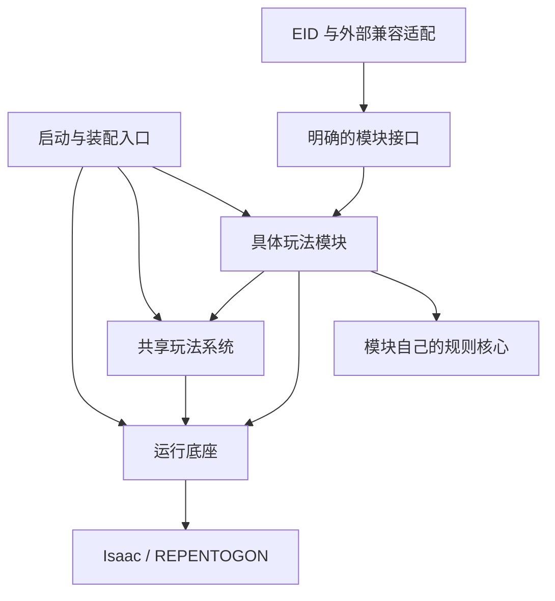

# Neverbirth 目标架构与渐进重构路线

日期：2026-11-24（Europe/Warsaw）  
状态：用户已认可架构方向；本文固化独立源码审阅结论，具体迁移尚未实施。  
适用项目：目录名 `neverbrith`，代码及公开对象中的 `Neverbirth` 等现有拼写分别保留。

## 1. 重构要达成什么

Neverbirth 的目标框架是：**运行底座精简、玩法模块完整、跨模块协作明确的模块化单体。**

开发一个新道具时，开发者应当只需要理解该道具的规则和少数公共接口。修改一个公共机制时，应当能明确列出受影响的模块、存档、回调与测试。

重构以这些能力衡量成果：

- 从道具名称能够直接找到它的规则、状态、接入和表现。
- 每份状态都有明确所有者、生命周期、保存策略和回退策略。
- 模块通过明确接口协作，不读取其他模块的内部存档表或测试入口。
- 关键回调顺序、返回值和重入行为能够解释并验证。
- 一个模块可以被独立测试；真实入口和关键组合也有集成检查。
- 每批迁移范围清晰，能单独验证、单独回退。

主文件变短、目录变整齐是这些边界形成后的结果，不能独立证明设计已经改善。

### 1.1 本文的依据与范围

本方案来自对当前工作区源码的独立审阅，未读取另一个聊天的回答，也未读取其重构方案。审阅覆盖启动入口、共享状态、代表性玩法、跨模块依赖及相关测试；不是对所有道具进行逐行审计。

本次只形成架构文档，不修改玩法实现。实现阶段以当时的源码、已确认设计与新执行的检查为准。

项目已有大量未提交改动。任何迁移都必须先辨认这些改动的归属，不能通过重置、清理或整文件覆盖来消除无关差异。

### 1.2 保持既有合同

沿用已确认的玩法、道具池、品质、资源风格、存档语义和公开兼容接口。若现有实现与已确认设计冲突，记录具体差异，再按相关合同处理。

架构整理不自动决定以下事项：

- 哪个道具应当压过另一个道具的输入或攻击。
- 某份状态是否应随沙漏回退、跨层保留或继续游戏恢复。
- 伤害支付、免伤、致死保护之间的新玩法关系。
- 新增依赖、修改原生运行时、提交、推送或发布。

## 2. 当前结构中的主要问题

审阅时 [main.lua](../../main.lua) 共 20,882 个物理行。这个数量描述当时快照，不作为长期验收门槛。

| 当前源码证据 | 结构问题 | 目标归属 |
| --- | --- | --- |
| `EnsureMusicboxDataLoaded()` 初始化八音盒、天使盒、骰子套装、黑太岁、记忆紊乱等数据 | 全项目存档设施与具体道具混合 | 独立存档服务；模块拥有自己的数据定义 |
| [斗气拳套](../../drive_glove.lua)与[凸眼鱼](../../blinky.lua)依赖 `PendingContentState.InventoryPlayerKey` | 公共身份能力归属于某批内容的历史接入模块 | 独立身份服务，保留不同身份语义 |
| `main.lua` 的斗气拳套装配读取 `RingOfSevenCursesTestAPI` | 正式协作和测试访问混在一起 | 正式查询接口；测试观察单独处理 |
| 炸弹套装、我即神明使用 `BurnAwayResentment.GetPlayerHeadWorldPosition` | 通用位置计算寄存在某件道具内部 | 玩家表现定位工具 |
| 骰子回调处注释说明其位置用于兼容测试按顺序取回调 | 测试依赖内部排列，限制源码组织 | 依照事件、过滤参数和行为寻找处理器 |
| [共享状态服务](../../pending_content_state.lua)同时处理身份、获取记录和快照参与者 | 多种可复用职责集中在历史功能名下 | 按实际职责提炼，保留已有行为证据 |

这些证据说明边界需要调整，不等于已经证明对应玩法存在运行故障。

### 2.1 应当保留的结构

- [斗气拳套规则核心](../../drive_glove_core.lua)已经把主要状态转移从接入代码中分离。
- [搓招识别核心](../../motion_input_core.lua)、[道具绑定](../../motion_items.lua)、[战斗执行](../../motion_combat.lua)和[表现](../../motion_presentation.lua)已经形成有价值的职责划分。
- [获取与快照服务](../../pending_content_state.lua)已有实物身份、临时复制和快照参与机制。
- [伤害顺序测试](../../tests/repentogon_damage_order_test.lua)使用真实入口的注册记录及已安装调度代码验证关键组合。
- [生成道具登记](../../generated/neverbirth_collectibles.lua)已有明确生成来源。

重构应当推广这些有效边界，继续使用其验证证据。

## 3. 目标结构与依赖方向



箭头表示依赖或使用；这不是统一的逐帧执行流程。玩法接入代码仍可以直接使用必要的引擎 API，不需要把每一个 `EntityPlayer` 方法再包装一遍。

| 部分 | 负责 | 边界 |
| --- | --- | --- |
| 启动与装配 | 前置检查、服务创建、依赖连接、模块安装、公开接口发布 | 不包含具体道具的规则和状态机 |
| 运行底座 | 存档读写、生命周期协调、身份解析、能力检测、日志和诊断 | 不点名判断具体道具的玩法 |
| 共享玩法系统 | 获取记录、输入与攻击占用、伤害来源等真实复用机制 | 只提炼已存在的共同合同 |
| 具体玩法模块 | 自己的规则、状态、接入和专属表现 | 通过正式接口使用外部能力 |
| 内容登记与文本 | 内部标识、运行时 ID 映射、语言文本、资源登记关联 | 每项事实有确定来源 |
| 外部适配 | EID、其他 Mod 登记、现有公开 API 的兼容 | 不通过内部状态表拼装功能 |

### 3.1 候选目录结构

下列路径仅用于表达目标归属，尚未创建。最终目录命名可结合迁移成本调整。

```text
main.lua                       薄入口：前置检查与装配
scripts/
  bootstrap.lua                显式创建和连接实例
  runtime/
    capabilities.lua           运行环境和扩展能力
    identity.lua               玩家、身体、运行时实体身份
    lifecycle.lua              生命周期协调
    persistence.lua            读写、版本和模块数据区域
    callback_registration.lua  薄登记层与诊断
  systems/
    acquisition.lua            实际获得、临时复制与实物记录
    control_ownership.lua      输入、移动和攻击占用
    damage_attribution.lua     已验证的伤害来源归属
    player_geometry.lua        通用玩家表现定位
  features/
    essential_balm.lua         简单功能保留单文件
    musicbox/                  八音盒自己的规则和接入
    drive_glove/               规则、接入、武器、声音、表现
    motion/                    输入、绑定、战斗、表现
  catalog/                     登记解析与文本消费
  integrations/                EID 与公开兼容门面
generated/                     生成产物及来源说明
tests/                         规则、模块、集成和资源检查
tools/                         检查、生成与交付工具
content/                       引擎内容登记
resources/                     引擎资源
```

目录只是职责的承载位置，不要求第一批就创建所有文件。只有真实职责和消费者明确后，才建立对应公共模块。

### 3.2 依赖约束

1. 底座不能随着每新增一个道具，就增加一个识别该道具的分支。
2. 共享服务由装配层创建并保有实例；消费者复用同一实例。
3. 功能之间的依赖在装配时明确传入，避免通过巨大 `context` 或全局对象任意查找。
4. 规则核心尽量只处理普通数据和明确输入；必要的时钟、随机源和外部查询显式提供。
5. 表现消费已经确定的状态或事件，不负责扣血、消耗、奖励和玩法计时推进。
6. 真正的功能依赖可以存在，但必须命名并验证；不要求所有模块在缺失必要服务时继续工作。

## 4. 具体玩法模块的合同

### 4.1 按完整玩法组织

一个简单被动可以保留单文件。复杂功能可以拆分为规则、运行接入、表现、状态定义等部分。

不把所有道具的更新逻辑集中到一个全局 `update.lua`，也不强制每件小道具都生成同样数量的文件。

以斗气拳套为例：

| 部分 | 输入与输出 |
| --- | --- |
| 规则核心 | 当前模式、斗气、逻辑时间、输入 → 状态变化及防御、力竭等结果 |
| 运行接入 | 引擎事件 → 调用规则 → 执行实际游戏操作 |
| 武器处理 | 根据已确认武器合同执行蓄力与发射相关操作 |
| 表现 | 读取已确定结果，绘制 HUD、播放音效及特效 |
| 状态定义 | 声明保存内容、清理条件、恢复和重建步骤 |

### 4.2 查询与操作分开

建议接口可以采用以下形状，名称为示例，不是现有 API 承诺：

```lua
feature.IsActive(player)
feature.GetIncomingDamageMultiplier(player)
feature.Execute(player, request)
feature.Cancel(player, reason)
```

查询应避免消耗游戏 RNG、扣费、修改道具池或触发效果。返回内部表时必须明确其所有权；优先返回必要的值、只读约定视图或副本。

操作必须说明成功、失败和取消的含义，并明确谁结算费用、冷却和奖励。一个引擎回调处理函数不自动成为通用效果 API。

正式调用方不得依赖 `TestAPI`。测试可以使用正式接口、可注入依赖或专门的观察设施，不能让生产模块通过测试入口协作。

### 4.3 模块实例与安装

可以继续采用现有 `return function(mod, dependencies)` 风格。复杂模块需要区分构造和注册时，再拆成显式阶段。

每个模块必须明确：导出什么、谁创建实例、何时注册回调、消费者是否共享实例、如何清理与替换。

`include` 每调用一次都会重新执行模块代码。因此不能为了获取一个方法，再执行一次有状态模块的初始化。装配层应保存返回实例并传给消费者。加载器缓存本身也不能代替生命周期管理。参考 [Isaac 模块加载文档](https://wofsauge.github.io/IsaacDocs/rep/tutorials/Using-Additional-Lua-Files.html#include)。

## 5. 状态与生命周期：最高优先级

### 5.1 三个维度分别定义

| 维度 | 要回答的问题 |
| --- | --- |
| 所有者 | 整局、逻辑玩家、角色身体、实体、房间，还是某份道具实物？ |
| 生命周期 | 创建、换房、换层、死亡、失去道具、退出和继续时怎样处理？ |
| 持久与回退 | 是否保存？是否随沙漏回退？恢复后重建哪些对象？ |

这些维度不能互相代替。属于整局的数据可以需要保存，同时明确不随沙漏回退。

每个模块维护自己的状态合同：

| 字段或状态组 | 所有者 | 创建与更新 | 清理条件 | 继续游戏 | 沙漏 | 恢复后重建 |
| --- | --- | --- | --- | --- | --- | --- |
| 迁移时逐项填写 | 使用经验证的身份语义 | 指明唯一推进者 | 按已确认规则 | 保存或重建策略 | 显式策略 | 缓存、实体、表现等 |

### 5.2 存档服务统一机制，模块保留含义

- 存档服务统一负责 JSON 和磁盘读写，以及明确的加载完成状态。
- 各模块注册自己的数据区域、默认值、版本、校验和迁移函数。
- 模块只获得自己所需的数据权限，不默认暴露整个存档根。
- 首批迁移通过适配层复用旧字段和旧格式；避免把代码搬迁与存档格式升级混为一批。
- 后续格式升级应有旧存档样本和迁移测试；遇到无法迁移的数据，明确报告，不能静默用空表覆盖。
- 保存可以合并，但必须保持原有结算点的可靠性；需要立即写入的场景应能明确请求。

### 5.3 沙漏采用显式参与机制

当前 [blinky.lua](../../blinky.lua)明确把储物袋放在共享沙漏快照之外，[motion_combat.lua](../../motion_combat.lua)则对战斗气量等状态维护快照。[pending_content_state.lua](../../pending_content_state.lua)已有参与者捕获和恢复接口。

目标框架应允许各模块注册捕获、清理、恢复和重建步骤，同时声明哪些数据参与回退。不能直接复制、恢复整个全局状态表。

恢复涉及相互依赖的模块时，顺序应有明确理由。具体边界由已有合同和测试决定，不能将某一功能的恢复顺序套用到所有功能。

### 5.4 身份服务提供不同身份语义

不强推一种万能 `PlayerKey`。至少要区分：

- 需要共享某些数据的逻辑玩家身份。
- 当前角色身体及其独立背包身份。
- 只在当前运行时有效的实体身份。
- 有独立耐久或来源记录的道具实物身份。

当前共享服务已经处理拉撒路形态共享与身体区分；[记忆紊乱](../../memory_disorder.lua)也区分持久键和运行时实体键。迁移应先保留这些差异，再用继续游戏、角色切换和多人案例验证映射。

不能仅凭种子、控制器索引或实体指针看起来唯一，就认定它能跨生命周期使用。

### 5.5 运行时数据独立管理

实体、玩家、Sprite、Room 等对象不写入存档。恢复后重新取得或重建。

模块不能继续持有恢复前已经被替换的数据表。延迟操作需要绑定所有者和有效生命周期，在换房、失去道具、退出或实例失效时按既有规则取消。

计时器需要注明逻辑帧、渲染帧或其他时钟单位，以及暂停和慢动作行为。一个状态阶段只能有明确的推进与结算所有者。

## 6. 优先提炼的共享玩法系统

| 能力 | 当前需求 | 提炼后的边界 |
| --- | --- | --- |
| 身份解析 | 多个模块自行组合种子、控制器和指针 | 按用途提供经验证的身份 |
| 获取与实物记录 | 区分碰撞、真正获得、临时复制和重新拾取 | 保留已确认来源与结算证据 |
| 输入和攻击占用 | 特殊攻击、背包选择器和主动道具之间协商控制 | 持有者明确，可释放自身占用 |
| 伤害分类与归属 | 普通伤害、支付伤害、持续伤害与击杀来源 | 提供已验证信息，不决定所有道具反应 |
| 玩家表现定位 | 多功能使用头部位置等计算 | 与具体道具解耦的工具 |
| 文本和内容查询 | HUD、提示、EID 使用同一内容身份 | 统一读取，保留不同显示面的需求 |

### 6.1 输入占用的目标

一个功能申请占用移动、射击或其他控制，获得属于自己的句柄。结束时释放自己的句柄，不能无条件恢复其他功能仍在限制的控制。

竞争、抢占、共存和取消规则必须显式表达，并保持已确认玩法。首批可以选择已存在互相避让的功能进行迁移，不能未经组合验证就覆盖全项目输入。

该服务只协调本模组明确拥有的控制；与第三方 Mod、原生角色机制的交互仍需要相应验证。

### 6.2 伤害服务的目标

共享已有的来源解析和分类工具，保留每件道具自己的触发政策。同一种支付伤害是否触发某道具，由该道具合同决定。

实际接受的伤害、命中尝试和伤害来源记录不能混为一件事。奖励或击杀归属应沿已验证的回执路径结算。

## 7. 原生回调与执行顺序

回调登记可以有薄封装，用于记录所有者、重复安装检查和诊断。原生事件、过滤参数、优先级和返回值语义必须保持。

每个关键回调记录：

| 项目 | 内容 |
| --- | --- |
| 所有者 | 哪个模块负责处理与清理 |
| 事件与过滤 | 原生回调及其正确过滤参数 |
| 顺序 | 优先级、必要的先后关系及理由 |
| 返回值 | 取消、修改、继续等实际语义 |
| 重入 | 是否可能再次触发，如何防止重复结算 |
| 生命周期 | 安装、解除或实例失效的时机 |

不把所有原生回调改成由一个总回调内部串行派发。尤其是伤害和输入事件，这种改法可能改变与其他 Mod 的执行穿插关系。

模块依赖顺序与游戏事件执行顺序分别处理：服务必须先创建，通过装配解决；伤害处理有先后要求，通过原生回调合同表达。

保留 [真实注册顺序测试](../../tests/repentogon_damage_order_test.lua)及[伤害调度测试](../../tests/repentogon_damage_dispatch_test.lua)。读取了已安装的 Lua 调度代码仍不等于验证了真实原生扣血和所有外部 Mod 组合。

## 8. 内容来源、能力边界和兼容接口

### 8.1 每项事实一个权威来源

本地 XML ID、运行时 ID 和内部功能标识分别建模。道具名、品质、道具池、资源和语言文本各自有明确来源，派生数据通过生成或检查保持一致。

继续利用 [现有生成登记](../../generated/neverbirth_collectibles.lua)及其生成器；不要求第一步重写全部 XML 和资源生产流程。生成结果不能成为第二份手工维护的内容定义。

### 8.2 必需能力与可选能力分开

保留当前 REPENTOGON 依赖政策。缺少必需能力时，应在玩法安装前给出明确诊断。

本地扩展能力和可选服务通过实际能力合同检测，消费者明确其缺失行为。不能用随处散落的静默兜底来掩盖必需服务缺失，也不能在所有可选服务未就绪前阻止独立功能工作。

脚本加载完成、外部服务就绪和当前游戏世界可用是不同条件；不通过任意等待一帧来替代依赖证明。

### 8.3 对外保留稳定门面

现有公开 `Neverbirth` 接口继续可用，通过薄适配委托给新的内部模块。公开接口的依据见 [兼容指南](../../COMPATIBILITY.zh-CN.md)。

后续新增接口可以提供版本或能力查询、明确的重复登记行为及所有者信息。旧接口的修改需要兼容测试，不能因为内部目录调整就改变外部消费者的合同。

## 9. 验证体系与验收标准

### 9.1 分层验证

| 层级 | 主要验证 |
| --- | --- |
| 规则测试 | 状态转移、计时边界、资源结算、纯计算 |
| 模块测试 | 原生接入参数、过滤条件、生命周期和服务调用 |
| 装配与集成测试 | 真实入口、依赖、注册次数、关键回调组合 |
| 内容与资源检查 | XML、生成登记、语言、资源路径和引用 |
| 原生验证 | 实际回调时序、输入、扣血、保存继续、沙漏及表现 |

公共夹具应独立于某个功能测试。当前部分测试从 `localization_test.lua` 中截取加载器，可以先提炼为正式夹具，同时保留原有断言。

普通行为测试避免依赖回调数组中的偶然位置；专门验证顺序的测试则必须继续检查真实顺序。搬迁后验证器也需要能够追踪新入口和目录，不能仅因扫描不到就报告成功。

### 9.2 框架验收用例

| 开发任务 | 目标结果 |
| --- | --- |
| 新增简单被动 | 修改自身功能、必要登记和测试；公共底座无需识别它 |
| 新增复杂主动 | 复用公共能力，同时自行拥有完整状态机 |
| 暂停加载某功能 | 无关模块保持工作，真实依赖者明确报告缺失 |
| 修改玩家身份规则 | 修改集中，相关生命周期和多人测试可定位 |
| 修改声音或 HUD | 游戏规则及结算结果不变 |
| 调整无关模块加载顺序 | 独立行为测试不受影响 |
| 继续游戏或沙漏恢复 | 数据行为符合各模块合同，没有旧引用或重复结算 |
| 调查异常 | 能定位事件、所有者、相关状态和实际结果 |

### 9.3 本次独立审阅已经执行的检查

执行日期：2026-11-24。运行器：`C:\Users\Anton\AppData\Local\Programs\Lua\bin\lua.exe`，版本输出为 Lua 5.4.6。

工作目录：`E:\Isaac - Repentance\mods\neverbrith`。实际 PowerShell 调用形式为：

```powershell
& 'C:\Users\Anton\AppData\Local\Programs\Lua\bin\lua.exe' -v
& 'C:\Users\Anton\AppData\Local\Programs\Lua\bin\lua.exe' 'tests/drive_glove_core_test.lua'
& 'C:\Users\Anton\AppData\Local\Programs\Lua\bin\lua.exe' 'tests/motion_input_core_test.lua'
& 'C:\Users\Anton\AppData\Local\Programs\Lua\bin\lua.exe' 'tests/pending_content_state_test.lua'
& 'C:\Users\Anton\AppData\Local\Programs\Lua\bin\lua.exe' 'tests/repentogon_bootstrap_test.lua'
& 'C:\Users\Anton\AppData\Local\Programs\Lua\bin\lua.exe' 'tests/repentogon_damage_order_test.lua'
```

| 检查 | 实际结果 | 退出码 |
| --- | --- | --- |
| 运行器版本 | Lua 5.4.6 | 0 |
| 斗气拳套规则核心 | 73 项断言通过 | 0 |
| 搓招输入核心 | 102 项断言通过 | 0 |
| 共享状态 | 获取、取消、队列、临时状态、回退、玩家及新局检查通过 | 0 |
| 启动前置 | 17 个场景及重复加载检查通过 | 0 |
| 真实注册顺序下的伤害组合 | 12 个场景通过 | 0 |

这些结果是重构前的代表性证据，不能写成全项目检查通过，也不能用于证明未来迁移后的版本。此次未启动游戏进行验收。

完整检查入口与范围以 [检查与证据](../agent/testing.md)及当前脚本为准。实施时按本批变化选择范围，不反复扩大无关测试。

### 9.4 重构开工验收标准

在开始实际迁移前，建立一份可复现、可恢复、可比较的项目基线。以下五项按本批迁移范围验收，证据可集中放在同一份基线记录中，无需拆成五个文档。

**当前状态**：本节定义验收要求，尚未执行这些开工核验。第 9.3 节的代表性测试结果不能代替完整开工验收。

#### 9.4.1 源码与运行环境一致

需要提供：

- 本次迁移的源码根目录、实际游戏加载目录、测试工作目录、发布输入和生成位置。
- 目录之间的复制、链接、安装或同步关系，以及用于核对同一批文件的清单或校验记录。
- 游戏版本、REPENTOGON 构建、实际扩展能力、必要配置和离线 Lua 运行器信息。
- 必需前置、可选服务及特定扩展接口的分类；相关能力缺失时的既有行为。

**通过条件**：能明确指出本批修改、测试和游戏验证分别使用哪份源码及资源，并证明其对应关系；相关环境可重现，必需与可选能力边界明确。环境升级不混入同一份结构迁移对照，必要升级单独记录和验证。

#### 9.4.2 恢复点完整且能够使用

需要提供：

- 包含已修改文件、必要未跟踪模块、XML、生成登记、运行资源和配置的恢复点。
- 基线文件清单、版本或校验信息；若使用 Git 提交作为依据，另行覆盖未提交内容。
- 经查明位置和范围的验证用存档副本，注明与原始游玩数据的关系。
- 在隔离位置恢复后的文件核对、必要加载检查和结果，注明检查层级。

**通过条件**：恢复点足以还原本批所依赖的实际开发状态；恢复出来的副本通过必要加载检查；存档试验使用副本，原始游玩进度不作为迁移实验对象。仅有备份目录或一个提交号不能判为通过；缺少必要原生检查时明确保留未验证项。

#### 9.4.3 真实加载关系与外部合同明确

需要提供：

- 从真实入口追踪的模块、实例和回调关系，区分当前运行、明确停用、生成产物、测试工具及历史副本。
- 本批涉及的 `include` 路径、模块导出、全局公开入口、存档字段、XML 名称与 ID、实体名称、资源引用和调试命令。
- 生成器、验证器、打包脚本和测试对路径、源码标记或文本形状的依赖。
- 将发生变化的接口、消费者及适配方式，以及需要同步的知识索引、专题或 Skill 入口。

**通过条件**：待迁移内容的真实消费者可定位，停用功能不会被新加载方式重新启用，历史材料不会混入运行清单。名称、ID、存档字段和资源路径的变化都有明确理由及兼容安排；第一批优先保留这些稳定标识。自动扫描目录不能替代真实加载关系核对。

#### 9.4.4 已知问题、测试基线与工具覆盖可解释

需要提供：

- 问题清单，分别标记已确认正常、已知缺陷、测试失败和未验证，并给出触发条件、依据及本批处理范围。
- 选定检查的实际命令、退出码、环境、警告和未运行项；复杂功能的固定场景及可观察结果。
- 测试发现、加载追踪、回调检查、生成与打包工具对目标结构的覆盖说明。
- 对改变扫描或加载规则的工具，保留能发现漏加载、缺失处理器或重复登记等相关反例的验证；记录实际扫描或加载范围。

**通过条件**：原有问题与本批引入的问题能够区分；与本批相关且会污染存档、造成重复结算或使基线无法加载的缺陷已处理到足以安全比较。其他失败和未知项有明确归属，不伪装成通过。工具能够检查迁移后的目标路径，不能将零发现、扫描遗漏或模拟默认成功当作验证成功。打包范围也覆盖目标目录和必要资源。

#### 9.4.5 试点范围、所有权与结束条件确定

需要提供：

- 一个有既有测试、具有一定状态与生命周期、依赖可解释且能独立撤回的真实玩法试点。
- 本批允许修改的文件、模块所有权、并行任务边界，以及固定的行为范围。
- 预期新接口、保留的旧合同、临时适配层及其退出条件。
- 规则、模块、真实入口、状态恢复和必要原生验证的选择，及可观察的结束条件。
- 代码撤回方法，以及是否涉及已经写入磁盘的数据。

**通过条件**：试点足以检验目标架构的关键边界，又能独立实施和撤回；新增玩法与结构迁移分别安排。若使用工作树，已经确认其中包含预期的未提交开发内容，不能把缺少现有功能的副本作为完整基线。验收目标包含玩法完整迁移、旧重复注册移除、状态合同保持和真实入口接入。

#### 9.4.6 开工验收记录与判定

| 准备项 | 状态 | 证据与范围 | 未满足项及对本批的影响 |
| --- | --- | --- | --- |
| 源码与运行环境一致 | 未核验 | 实施前填写 | 实施前填写 |
| 恢复点完整且能够使用 | 未核验 | 实施前填写 | 实施前填写 |
| 加载关系与外部合同明确 | 未核验 | 实施前填写 | 实施前填写 |
| 问题、测试与工具覆盖可解释 | 未核验 | 实施前填写 | 实施前填写 |
| 试点范围与结束条件确定 | 未核验 | 实施前填写 | 实施前填写 |

状态使用“通过、未通过、未核验”；确实不适用的单项写明范围和理由，不以空白代替核对。相关必需条件没有证据时，不宣布本批具备开工条件；可以继续独立的源码调查、基线整理和验证准备。

后续批次复用仍然有效的基线证据，并核对源码、环境和迁移范围是否变化。只重做受变化影响的检查，不机械重复整套准备。

### 9.5 首批试点完成验收

开工验收证明准备充分；试点完成还需满足以下条件：

- [ ] 一个真实玩法已经完整迁入目标边界，规则、接入、状态和表现的所有者清楚。
- [ ] 必要依赖显式接入，生产代码没有新增对测试接口或其他模块内部存档表的依赖。
- [ ] 真实入口加载新实现，旧重复实现和注册已经移除，或有明确且不会双重执行的适配。
- [ ] 固定场景的前后结果保持约定行为；单独修复的缺陷有自己的变化说明和验证。
- [ ] 新局、继续、沙漏、取消及清理等相关生命周期符合既有合同，涉及身份时包含相应多人或角色切换覆盖。
- [ ] 选定自动检查及必要原生验证实际完成；警告、失败和未验证项分别报告。
- [ ] 验证器、生成器、打包及项目导航能够识别迁移后的结构；涉及的维护入口已同步。
- [ ] 代码和数据的撤回方式明确，临时适配层的消费者及退出条件已记录。

完成条件按试点实际合同选择；确实不适用的项目给出理由。自动检查通过不能替代所需原生验证，也不能自动代表用户手感或画面验收通过。

### 9.6 属性、性能、失败处理与最终交付验收

以下六项补充第 9.4 节的开工准备与第 9.5 节的试点验收。每批按实际影响范围选择，整轮收工时汇总；涉及的项目必须有证据，确实不适用的项目说明理由。

**当前状态**：本节仅新增验收标准，相关检查尚未执行，不能据此宣称属性、性能、失败清理或打包产物已经通过验证。

#### 9.6.1 属性计算顺序与重复刷新

检查内容：

- 对本批涉及的伤害、射速、幸运等属性，比较单独持有与关键组合下的最终值。
- 核对加法、倍率、上限、覆盖及临时加成的计算顺序；公式不变仍可能因顺序变化而改变结果。
- 在相同玩家状态下重复触发缓存刷新，检查结果是否保持一致。
- 验证获得、失去道具和临时效果结束后的属性恢复。
- 检查缓存刷新是否意外重复发放奖励、扣费、触发玩法效果或推进随机数。

**通过条件**：固定条件下的属性符合既有合同；重复刷新没有累计漂移或重复结算；相关道具组合与效果移除后的值保持正确。缓存计算与一次性结算的职责清楚。

**证据**：记录场景、初始状态、刷新次数、前后属性及副作用计数，附实际命令和退出码；依赖原生属性行为的部分提供对应引擎验证。

#### 9.6.2 初始化失败与部分安装清理

检查内容：

- 将能提前确认的必需依赖、资源和能力条件放到产生注册副作用之前检查。
- 分别验证必需条件缺失、可选能力缺失，以及已经开始安装后失败的处理路径。
- 检查失败后是否遗留回调、外部登记、输入占用、延迟操作或运行时对象。
- 明确失败后该功能的状态；独立可用部分只能按已定义合同继续运行。
- 检查重复清理、重新安装或重载是否产生重复注册及旧实例引用。

**通过条件**：诊断能够指出失败的功能和原因；失败状态符合明确合同，没有会继续执行的不完整玩法或无人管理的副作用。大范围 `pcall` 吞掉异常不算启动成功；引擎托管清理与项目自行清理的责任分别明确。

**证据**：至少覆盖本批相关的缺失依赖或安装失败场景，记录前后注册、占用及实例状态和清理结果。确实无法原子安装的部分，说明保留行为与恢复路径并验证。

#### 9.6.3 架构约束的自动检查

对真实加载范围建立并运行以下相关检查：

- 生产代码没有新增对 `TestAPI` 的依赖，已有待迁移依赖有清单。
- 运行底座不反向加载具体玩法模块。
- 同一功能的新旧实现没有同时注册并生效。
- 明确停用的功能没有因目录扫描或新装配方式被启用。
- 生成产物与其权威来源保持一致。

**通过条件**：适用约束可以重复检查，扫描范围与工具局限有记录。新增或修改检查器时，以相应反例证明它能发现目标问题；仅匹配到部分文本不能宣称完成全部依赖分析。保留例外注明位置、理由、消费者及适用范围。

**证据**：实际扫描文件或模块清单、检查命令、退出码、相应反例结果及例外清单。加载方式变化后复核覆盖，不能以漏扫形成的零错误验收。

#### 9.6.4 性能基线与迁移后对照

根据本批影响范围，从下列场景选择对照：

| 场景 | 重点观察 |
| --- | --- |
| 未持有相关道具 | 公共框架是否进行大量无效更新、遍历或保存 |
| 普通战斗 | 逐帧更新耗时、实体遍历次数和调用频率 |
| 多敌人与多特效 | 状态复制、临时分配、垃圾回收及帧耗时波动 |
| 多人和关键组合 | 玩家、模块与实体之间是否出现重复的乘积式处理 |
| 换房、保存与沙漏 | 瞬间停顿、重复写入、重建和恢复开销 |

**通过条件**：前后测量使用相同运行环境及可比较场景，并记录测量工具、预热、采样方法和基线波动。事先明确本批比较的指标和判定方法；出现超出合理波动的退化时，定位原因并处理，或明确列为未通过项。没有测量证据时不宣称性能改善，回调数量减少也不能单独证明改善。

**证据**：保留可对应到基线与候选版本的测量结果，并验证测量代码不会显著扰动被测场景。仅改文档等不影响运行的批次可说明不适用，不要求每批运行全部性能场景。

#### 9.6.5 实际打包产物验证

检查内容：

- 使用实际打包流程生成本地验证包，核对新目录、必要 Lua、资源、生成登记和语言模板均已包含。
- 在隔离位置展开并按实际加载方式检查，不能依靠原源码目录里的临时文件或未打包文件补足依赖。
- 核对路径及大小写、清单与版本信息，并确认测试副本和历史代码没有被误装入运行链。
- 从包中执行或针对包内容执行必要加载、资源和行为检查；记录实际测试对象。
- 检查验收记录与包的版本、文件清单或校验信息相对应。

**通过条件**：实际产物具备已声明的运行条件，所需文件完整且加载路径正确，验证对象与交付候选一致。源码目录通过检查不能替代包级验证；必需的原生加载检查尚未完成时保留未验证状态。

**证据**：打包命令、退出码、产物位置与标识、内容清单、隔离加载和必要检查结果。制作及验证本地包不代表正式发布，提交、推送和上传继续遵循明确授权。

#### 9.6.6 整轮重构的完成边界

检查内容：

- 对照开工时确定的范围，列明本轮迁移模块、保持现状模块和延期项目。
- 每个范围内模块能够说明实现与状态所有者、正式依赖、关键生命周期和同类功能的接入位置。
- 旧入口、旧实现和临时适配层有明确去向；仍保留的部分列明消费者、理由及退出条件。
- 汇总实际验证、必要原生验收、已知问题和未完成项，不能以拆分文件数代替完成度。
- 必要维护文档、生成与打包流程跟随实际结构更新。

**通过条件**：本轮必需交付及所需验证均完成，剩余事项明确处于既定范围之外或被记录为后续工作；范围变化保留原因，不能在收工时静默删去未完成要求。边界清晰、验证充分的模块不因风格差异被强制重写，也不要求所有模块采用相同文件数量。

**证据**：按模块汇总迁移状态、接口、旧入口去向、验证记录和后续事项。仍有范围内必需工作未完成时，报告阶段性交付，不将整轮重构标记为完成。

#### 9.6.7 补充验收记录

| 验收项 | 状态 | 本批适用范围 | 证据、例外与未完成项 |
| --- | --- | --- | --- |
| 属性计算顺序与重复刷新 | 未核验 | 实施时填写 | 实施时填写 |
| 初始化失败与部分安装清理 | 未核验 | 实施时填写 | 实施时填写 |
| 架构约束自动检查 | 未核验 | 实施时填写 | 实施时填写 |
| 性能对照 | 未核验 | 实施时填写 | 实施时填写 |
| 实际打包产物 | 未核验 | 实施时填写 | 实施时填写 |
| 整轮完成边界 | 未核验 | 收工时核对本轮范围 | 实施时填写 |

沿用第 9.4.6 节的状态含义。无需在每个小批次重做整轮包级和收工检查，但相关改动必须记录对这些最终验收项的影响，整轮交付时补齐证据。

## 10. 渐进迁移路线

| 阶段 | 主要工作 | 进入下一阶段前的证据 |
| --- | --- | --- |
| 0：基线与合同 | 确认当前工作区；整理公共夹具；记录关键回调、公开接口和状态合同 | 第 9.4 节开工验收有实际证据；既有失败与本次差异分开 |
| 1：基础服务 | 提炼存档、身份和生命周期协调，保留旧格式适配 | 新局、继续、沙漏、身份映射等目标场景符合旧合同 |
| 2：完整玩法迁出 | 按功能迁移主文件中的实现，显式传入依赖 | 首批按第 9.5 节验收；后续按同样的相关合同检查行为、注册和资源，移出后无重复安装 |
| 3：跨模块协作 | 提炼输入占用、获取记录和共享查询；替换生产代码的测试接口依赖 | 相关功能组合测试及必要原生验证通过 |
| 4：接口与内容来源 | 收紧公开边界，整理文本与登记来源 | 兼容接口、生成一致性和资源消费路径通过检查 |
| 5：性能与维护 | 根据测量处理重复遍历、无效更新和重复保存 | 有可比较的性能证据，玩法时序和生命周期不变 |

每阶段可以分为多个小批次，不要求阶段内一次完成全项目迁移。优先选有明确所有者和现成测试的功能作为试点，再逐步扩大。

每批迁移至少记录：

- 迁移对象及新的职责边界。
- 实例、回调、状态和资源的所有者。
- 保留的玩法、存档及公开接口合同。
- 实际修改文件，哪些旧入口继续作为适配。
- 执行命令、退出码、警告、未运行项和原生验收范围。
- 如何单独撤回本批改动，以及是否涉及存档格式迁移。

### 10.1 第一批建议交付物

1. 一份当前关键模块的依赖与状态清单，先覆盖存档、身份、伤害及输入。
2. 独立公共测试夹具，消除从本地化测试截取加载器的依赖。
3. 维持旧格式的存档服务适配，以及直接相关的生命周期测试。
4. 一个完整玩法迁移试点，展示规则、接入、状态和正式接口如何组织。
5. 对真实入口、回调注册和旧公开接口的集成检查。

第一批的成果应当足以证明后续功能可以沿用同一方法迁移，而不只是把大文件分成几个同样耦合的文件。

## 11. 后续实施时的判断准则

遇到新的抽象提议，先回答：它服务哪些真实消费者，消除了什么重复，谁拥有状态，谁负责清理，怎样验证保持行为。

遇到玩法或持久化语义不清楚的地方，记录具体缺口并继续不依赖该决定的工作。不能借“统一框架”替用户决定尚未确认的规则。

这次重构的首要交付是明确的状态所有权、模块接口和回调合同。文件布局、命名、生成工具与性能整理围绕这些合同逐步完善。

### 11.1 分开结构调整与行为修改

每批改动聚焦一个可解释的问题，例如将八音盒迁为独立模块，并保持原有触发、计时、结算和保存行为。避免同批同时改变代码位置、调用顺序、状态格式和玩法，否则很难定位行为差异。

迁移前区分三类依据：

- 已确认的玩法要求。
- 当前实现的实际行为。
- 已知缺陷或尚未确认的行为。

迁移中发现的缺陷可以修复，但应独立说明触发条件、行为变化和验证结果。不要将顺手修复混入结构变更，也不要把已知缺陷永久固化为正确合同。

### 11.2 验证测试本身能发现退化

保留现有断言的行为含义。不能通过删掉断言、降低要求或增加默认成功的模拟方法来让迁移后的测试通过。

对关键测试检查以下反例：

- 被测功能没有注册或没有加载，测试是否失败？
- 回调没有执行，测试是否失败？
- 功能执行两次或奖励结算两次，测试是否失败？
- 被测结果被固定成默认值，测试是否仍错误地通过？

单个模块测试与真实入口集成检查同时保留。公共夹具提炼后，依然需要验证实际模块是否加载、必要服务是否接入，以及回调是否只安装一次。

### 11.3 保存可比较的行为证据

对复杂功能选取少量固定场景，记录初始条件、操作和可观察结果，供迁移前后对照：

| 场景 | 至少记录 |
| --- | --- |
| 获得道具 | 初始资源、状态、属性及必要反馈 |
| 完整使用一次 | 消耗、效果、奖励、冷却和结束状态 |
| 换房或换层 | 应保留、清除及重新建立的内容 |
| 退出并继续 | 保存值、身份重绑和运行时重建结果 |
| 沙漏恢复 | 参与回退与不参与回退的数据 |
| 关键组合 | 与相关道具共存时的顺序、资源及结果 |

斗气拳套和搓招系统应额外记录计时边界、交还控制的时刻及奖励结算点。只证明能够发动，不能证明完整流程保持一致。

对照场景尽量固定输入与环境，同时记录实际运行版本。不要让原生依赖升级、资源替换与结构迁移混在同一份前后比较中。

### 11.4 区分加载、就绪和恢复

文件加载完成、服务实例已创建、游戏已经开始、玩家已经存在、存档恢复完成，分别是不同条件。

迁移时明确以下阶段及其依赖：

1. 创建模块并连接依赖。
2. 安装回调。
3. 新局初始化或继续游戏恢复。
4. 换房及角色变化后的运行时重建。
5. 退出、卸载和实例替换时的清理。

具体原生事件的先后关系以实际合同和验证为准，不能用上述逻辑阶段推测引擎一定按某种顺序回调。

避免以任意延迟一帧或“缺数据就新建空表”掩盖依赖未就绪。尤其要防止模块先建立默认状态，再覆盖稍后才恢复的真实存档。

### 11.5 包装原生回调时保留细节

除了验证处理器被调用，还要逐项核对参数、过滤条件、优先级、必要顺序、返回值、同步时机和重入行为。

`nil`、`false`、数值和返回表可能有不同含义。Lua 中 `result or fallback` 会替换有意义的 `false`；这类通用包装不能直接用于所有回调。

原本同步执行的操作不能为了统一调度而自动改成延迟队列。嵌套触发也不能因拆模块而丢失原有的重复结算保护。

真实注册顺序和已安装调度代码的检查应继续保留，不能用更简单的模拟调度器替代其关键覆盖。必要时仍需原生引擎验证。

### 11.6 随机数消费顺序属于行为合同

相同种子的结果还取决于 RNG 调用次数、调用顺序和所用随机流。将原本使用时的抽取提前到初始化，或在预览、HUD 查询中增加抽取，都可能影响后续结果。某些道具池查询也会产生实际副作用。

明确区分候选查询、预览、实际抽取和提交消耗。迁移时保持既有随机源与消费时机；为了缓存、展示或诊断而增加的代码不得意外推进游戏 RNG。

### 11.7 同时考虑代码与存档的撤回

代码能够撤回，不代表已经写入磁盘的新格式仍能被旧代码读取。

首轮优先保持旧格式，通过适配层改善内部接口。格式升级单独验证以下事项：

- 旧版本识别和迁移路径。
- 迁移失败时原始数据的保留。
- 重复加载不会重复迁移或重复发放内容。
- 撤回代码后旧版本读取数据的行为。
- 新局与继续游戏的区分。

局种子相同不等于同一局。同种子重新开始仍需执行新局重置；保留现有共享状态测试对这一场景的覆盖。

### 11.8 检查功能结束后遗留的影响

停止更新并不等于已经清理。需要核对功能施加的控制限制、实体冻结、临时属性、服饰、视觉变换、持续声音、延迟结算及外部持有的旧实例引用。

相关取消和清理路径应可重复调用，并覆盖该玩法涉及的成功结束、失败、失去道具、死亡、换房、退出和卸载场景。

释放控制只解除本功能拥有的占用。A 结束时不能无条件恢复 B 仍在限制的移动或射击。

### 11.9 提前验证多人及角色切换

身份与状态服务的首批验证就应包含已有的双子、拉撒路形态、记忆紊乱及背包身份相关场景，不能等单人实现固定之后再补这些语义。

从现有合同确认哪些身份共享、哪些身体独立，以及切换和继续时如何重绑。只用单人以撒跑通一次，不能证明公共身份服务正确。

### 11.10 保持并行任务和改动批次的边界

每批开始前记录当前工作区及允许修改的文件，明确各任务的模块所有权。公共接口先明确合同，避免多个任务各自建立一套服务。

发现同一位置已被其他任务修改时，核对差异后再继续。不能通过整文件覆盖、`reset` 或 `clean` 清除无法解释的改动。

独立工作树必须确认包含预期的开发状态。从当前提交新建工作树，可能漏掉主工作区尚未提交的现有功能。不得将一个缺少这些功能的副本当作完整迁移基线。

### 11.11 固定迁移范围并安排旧入口退出

迁移某模块期间固定其行为范围。新增道具或新玩法需求应作为独立变更安排，避免底座合同不断变化，使迁移无法收口。

临时兼容层必须说明现有消费者、替代入口和删除条件。例如：全部生产消费者切换到正式倍率查询，并通过组合检查后，移除对旧测试接口的运行依赖。

按完整迁移的功能及消费者统计进度。拆出的文件数不能说明旧体系已经退出；长期同时维护旧体系、新体系和适配层会继续增加理解成本。

## 12. 每批迁移交付记录模板

该模板用于本地迁移记录；具体命令和测试数量必须填写本批实际结果，不沿用本文第 9.3 节的历史通过记录。

| 项目 | 填写内容 |
| --- | --- |
| 本批目标 | 要消除的具体结构问题及本批完成条件 |
| 基线与所有权 | 所用源码状态、已有无关改动、负责模块和协作边界 |
| 开工验收 | 第 9.4 节五项准备的状态、证据及本批变化后需要重核的范围 |
| 变更范围 | 修改的模块、接口、文件及必要依赖 |
| 行为合同 | 必须保持的行为，以及单独说明的缺陷修复 |
| 状态与顺序 | 所有者、保存与沙漏策略、关键回调和清理路径 |
| 验证结果 | 实际命令、退出码、原生验证、警告和未覆盖范围 |
| 补充质量验收 | 第 9.6 节适用项的状态与证据；对最终包级验证及整轮完成边界的影响 |
| 撤回方式 | 如何撤回代码，是否影响已保存数据及其处理方法 |
| 剩余迁移 | 仍走旧入口的消费者、替代入口和删除适配层的条件 |

第一批试点应证明：一个真实玩法能够完整迁入新结构，保持约定行为，且测试、存档、依赖、回调和清理路径都能解释。取得这组证据后，再沿同样方法扩大迁移范围。
